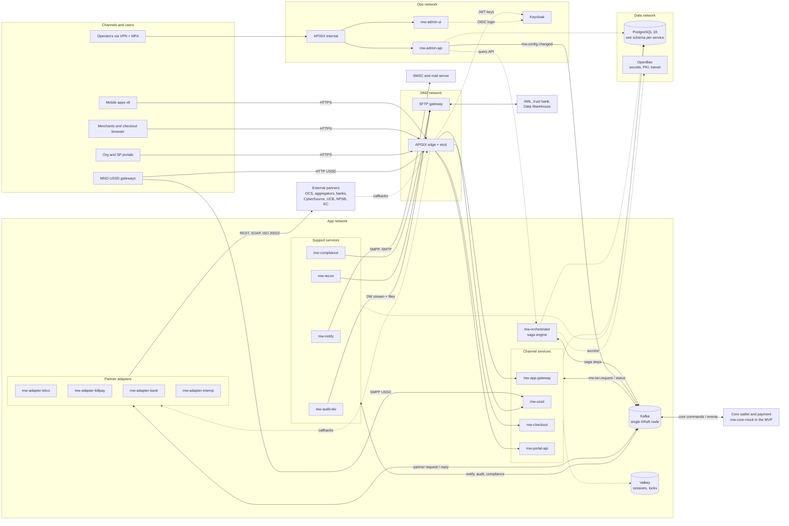

# upay MFS Middleware — Implementation Specification

Nov 3, 2026 · @Ahmad Naqibul Arefin

## 0. Document control

This spec turns the upay *Mobile Money Middleware RFP v0.1* into a build-ready design for the integration layer, using Apache Camel, Kafka, APISIX, Spring Boot 4, JDK 25 and PostgreSQL 18. Requirement IDs (OWN, FR, NFR, SEC, ENV) are the RFP's; section 24 traces each one to its design.

**Conventions.** MUST / SHOULD / MAY follow RFC 2119. Values marked **TBC** are assumptions to confirm (section 25). `mw-*` names modules and services.

**Revision 3 (Nov 3, 2026).** Gradle replaces Maven (D13); package root is `mfs.mw.<service>`; every service uses a conventional layered Spring Boot structure (controller, service, repository, entity, dto, exception and so on), with no Spring Modulith and no ArchUnit (D15). Sections changed: 0, MVP build plan, 3, 4.2, 4.3, 7.1, 12, 18.3, 20.1, 22.1, 23.1, 25.

**Revision 2 (Nov 3, 2026).** Adds decisions D11–D14: no high availability for any component, Docker Compose for every component including platform tools, a multi-module build in which every module is an independently deployable Spring Boot application, and no shared library or common module. Sections changed: MVP scope and build plan, 0, 2 (architecture diagram), 2.1, 3, 4, 5, 6.1, 8, 9.2.1, 10.4, 12, 16, 18, 19, 20, 21, 22, 23, 25.

### Decisions confirmed

| # | Topic | Decision |
| --- | --- | --- |
| D1 | Integration engine | Apache Camel 4.x on Spring Boot 4, JDK 25 (virtual threads on) |
| D2 | Messaging backbone | Apache Kafka (KRaft mode, no ZooKeeper) |
| D3 | API gateway | Apache APISIX |
| D4 | Middleware database | PostgreSQL 18 (confirmed), used only where the middleware needs its own state; services access it through Spring Data JDBC/JPA, no PostgREST |
| D5 | Core wallet / payment link | Asynchronous Kafka commands and events; no synchronous calls into the core |
| D6 | Admin console | Next.js 16.3.8 (App Router, TypeScript) |
| D7 | USSD | One adapter abstraction; SMPP or HTTP transport selected per MNO by configuration |
| D8 | Runtime | Docker images; every component, including platform tools, runs under Docker Compose (see D12) |
| D9 | Platform services | Keycloak (IAM/SSO), HashiCorp Vault or OpenBao (secrets, PKI), Resilience4j (resilience) |
| D10 | Excluded from this spec | Kubernetes, Helm, Argo CD, GitLab CI/CD, OpenTelemetry/Prometheus/Grafana/Loki/Tempo, and for the MVP Apicurio Registry, Avro and Harbor; CI/CD and observability tooling are chosen separately. This spec only defines what services emit and how they are built (sections 20–21) |
| D11 | Availability | No high availability for any component, in any environment: one instance of each, no clustering, replication, failover or second data centre, and no extra replicas for throughput either. Recovery is by container restart and, after host or volume loss, restore from backup (section 19.3) |
| D12 | Deployment | Docker Compose for everything: Kafka, PostgreSQL, Valkey, Keycloak, OpenBao, APISIX/etcd, SFTP, every `mw-*` service, the admin UI and simulators. Nothing is installed natively on a host or run by another team's platform (section 20.2) |
| D13 | Build | One Git repo built with Gradle (Kotlin DSL). The root is a Gradle composite build for convenience only; every module is its own standalone Gradle build and a complete Spring Boot application that builds, tests, ships as its own image and deploys on its own (section 4.2) |
| D14 | Code sharing | No library, common, starter or test-kit module. Services share only contract files (JSON Schema, OpenAPI, AsyncAPI, WSDL/XSD, Pact), kept in one root `contracts/` folder that holds no code; each module pins its own dependency versions (no shared parent or BOM module); cross-cutting code is copied from a service template, never depended on, so any module can move to its own repo with no code change (section 4.3) |
| D15 | Code structure | Package root `mfs.mw.<service>`. Conventional layered Spring Boot structure in every service: `controller`, `service`, `repository`, `entity`, `dto`, `mapper`, `exception`, `config` and a few integration packages (section 4.4). No Spring Modulith, no ArchUnit; layering is enforced by code review and the conventions in `CLAUDE.md` |

### Assumed sizing (TBC)

The RFP leaves volumes blank, so the design sizes for: **1,500 TPS peak, 300 TPS average, 3x headroom (4,500 TPS tested)**, middleware overhead **p95 < 150 ms**. With no HA (D11) the deployment is one site with one instance of every component, so the targets become **99.5% availability** (planned maintenance excluded), **RPO ≤ 5 min** (continuous WAL archive) and **RTO ≤ 4 h** (rebuild and restore), all TBC. Section 19 holds the full NFR table.

## MVP scope (current build target)

The MVP proves every core pattern of the middleware on one Docker Compose host: four channels, five flow families, a mocked core and simulated partners. Real partners and back-office functions follow once the patterns are accepted. Where this section and sections 1–25 differ, this section wins for the MVP.

### MVP decisions

| # | Topic | MVP decision |
| --- | --- | --- |
| M1 | Flows | `P2P`, `CASH_IN`, `CASH_OUT`, `TOPUP`, `BILL_PAY`, `ADD_MONEY_BANK` (C2W); `MERCHANT_PAY` through web checkout and the merchant app |
| M2 | Channels | Customer, Agent and Merchant apps (REST only, no SOAP facade); USSD for 1 MNO; web checkout API; Org/SP portal API |
| M3 | USSD transport | SMPP and HTTP both implemented; the transport is chosen per MNO by configuration. GP over SMPP is live in the MVP; Robi, Banglalink and Teletalk are config-ready, and HTTP mode is proven against the simulator |
| M4 | Core | `mw-core-mock`: a new service that implements the proposed Kafka contract (section 6.3) with a simple PostgreSQL ledger, so balances, holds and reversals behave realistically |
| M5 | Partners | Simulators only (`mw-simulators`), built to a generic contract per partner type; real API mappings come later |
| M6 | Admin console | Ops essentials: login, transaction search and saga timeline, manual TSQ / reversal with maker-checker, partner enable/disable and timeouts, USSD menu and SMS template editing |
| M7 | Platform | Keycloak, Vault/OpenBao, Valkey, Kafka (KRaft), PostgreSQL 18, APISIX, notifications (SMS over SMPP + email) |
| M8 | Footprint | Single host, Docker Compose, no HA; the same single-instance model as production (D11), only smaller |
| M9 | Serialisation | JSON on Kafka with JSON Schema files in Git; no Apicurio, Avro or Harbor |
| M10 | Delivery | Built mainly by coding agents (Claude Code); work is sliced into small, testable packages (next section) |
| M11 | PIN | Target scheme from day one: apps encrypt the PIN with the core's public key (RSA-OAEP); mw-ussd encrypts on receipt; the middleware only forwards ciphertext; mw-core-mock holds the private key (in OpenBao) and checks a bcrypt hash |
| M12 | Code review | An upay engineer reviews and approves every pull request, including agent-written ones; milestone demos on top |
| M13 | Repo and CI | GitHub repo owned by upay; no CI/CD in the MVP. Tests run locally through Makefile targets; the PR carries the test report and the reviewer re-runs make verify before merging |

### In the MVP vs deferred

| Area | In the MVP | Deferred |
| --- | --- | --- |
| Orchestration | Full state machine, idempotency, outbox/inbox, timers, TSQ, reversal, `MANUAL_REVIEW` | Post-restore recovery sweep (19.3) |
| Partner adapters | `mw-adapter-telco` (OCS sim), `mw-adapter-billpay` (1 aggregator sim), `mw-adapter-bank` (C2W bank sim) on the adapter SDK with route templates | CyberSource, UCB ATM / IMT, merchant SOAP, NPSB/BanglaQR, remaining banks and aggregators |
| Notifications | SMS (SMPP 3.4 to SMSC sim) and email (SMTP to GreenMail); bn/en templates; DLR tracking | Push, quiet hours, channel fallback |
| Portals | Org bulk disbursement (CSV upload up to 10,000 rows, maker-checker, child txns); SP transaction query | SFTP bulk drop, SP self-service extras |
| Compliance | Audit trail (append-only table + hash chain), masking everywhere | AML feed, EC eKYC, block/hold instructions |
| Reconciliation | None | MT940/942, settlement matching |
| Data | Audit events in PostgreSQL | DW stream and batch, archival |
| Gateway | APISIX with JWT (Keycloak), HMAC for checkout merchants, rate limits, request validation | mTLS partner callbacks, separate internal gateway |
| Ops | Health checks, structured JSON logs, `/actuator/prometheus` metrics | Alert rules, runbooks per alert, backup restore drill |
| Security | TLS on the APISIX edge, Vault for all secrets, Keycloak MFA for admin, non-root containers | mTLS between services, HSM, pen test (before production); Kafka ACLs and quotas; image digest pinning |
| Dev secrets | OpenBao root token kept in its data volume (dev only) | Production unseal and root-token handling |

### Single-host topology

One Compose project (`deploy/compose/mvp/compose.yml`, which `include`s the platform file and each module's own `compose.yml`, section 20.2) on one Linux VM, sized at about **16 vCPU, 64 GB RAM, 500 GB SSD** (TBC). All containers share one internal network; only APISIX (443), the SMPP/USSD port and the admin UI (via APISIX) are published.

| Group | Containers |
| --- | --- |
| Edge | `apisix`, `etcd` |
| Channels | `mw-app-gateway`, `mw-ussd`, `mw-checkout`, `mw-portal-api` |
| Core flow | `mw-orchestrator`, `mw-core-mock` |
| Partners | `mw-adapter-telco`, `mw-adapter-billpay`, `mw-adapter-bank` |
| Support | `mw-notify`, `mw-audit-dw` (audit only), `mw-admin-api`, `mw-admin-ui` |
| Platform | `kafka` (single KRaft node, RF 1), `postgres` (18), `valkey`, `keycloak`, `openbao`, `kafka-init` (one-shot topic creation); no migration container, each service runs its own Flyway migrations on start (16.4) |
| Test | `mw-simulators` (OCS, aggregator, bank, SMSC, USSD gateway in SMPP and HTTP mode), `greenmail` |

### Core mock (`mw-core-mock`)

- Consumes `core.wallet.command.v1` and `core.payment.command.v1`; emits the events in section 6.3 with the same `commandId` deduplication the real core must provide.
- Ledger in its own schema `coremock`: `wallet(id, msisdn, type, status, balance_minor, held_minor, pin_hash)`, `hold`, `entry` (double entry), `command_log`. Seed data: 1,000 customers, 50 agents, 20 merchants, 2 orgs.
- Rules kept simple and configurable: flat fees per `txnType`, per-txn and daily limits, PIN check (bcrypt), insufficient-funds rejection.
- Fault injection by admin endpoint: delay, drop reply, duplicate reply, reject, so `UNKNOWN` and TSQ paths can be exercised.
- It is a test double, not a product: it never ships to production and is replaced by the real core with no change to the orchestrator.

### MVP acceptance criteria

1. Every MVP flow completes end to end from its channel against simulators, with success, business failure, timeout → TSQ → commit, and timeout → TSQ → release scenarios passing in an automated e2e suite.
2. Repeating any financial request with the same idempotency key never moves money twice (proved by tests that check core-mock balances).
3. Killing any one middleware container mid-flow leaves no transaction in a non-terminal state after restart and sweeps.
4. Operator can find a transaction by txnId or MSISDN, see its saga timeline and audit, and run a reversal approved by a second user.
5. USSD works for the live MNO over its configured transport, and switching that MNO's config between SMPP and HTTP needs no code change.
6. `docker compose up` on a clean host brings up the full stack with seeded data in under 15 minutes, from the repo alone (OWN-06).
7. Single-host throughput of at least **100 TPS** mixed load with p95 middleware overhead under 150 ms (TBC; a sanity check, not a production sizing).

## MVP build plan for coding agents

The MVP is built as about 30 small work packages (WPs), each sized for one coding-agent session: one module, a written contract to build against, and tests that prove it is done. Contracts come first, so agents can work in parallel without guessing each other's interfaces. Humans own review, merges and the decisions below.

### Ground rules for agent work

- **Repo memory.** The repo root holds `CLAUDE.md` with conventions: package layout (section 4.2), error model (5.3), masking rules (18.3), logging fields (21.1), test commands, and "never" rules (no secrets in code, no `System.out`, no field injection, no blocking on Kafka threads). Each service has its own short `CLAUDE.md` with its responsibilities and the contracts it owns.
- **Contract first.** Every WP starts from files in the root `contracts/` folder (OpenAPI, AsyncAPI, JSON Schema). Each file has an owning service, recorded in `contracts/OWNERS.yml`; an agent may not change a contract its service does not own; contract changes are their own WP, reviewed by a human.
- **Definition of done = green tests.** Each WP lists its acceptance tests; the agent writes them first, then the code. With no CI/CD in the MVP, a WP is merged only when `./gradlew check` (or `pnpm test` for the UI) and the relevant e2e scenario pass locally, the agent has attached the test output to the PR, and the reviewer has re-run make verify.
- **Local quality gate (no CI/CD in the MVP).** Makefile targets replace a pipeline: `make up` (Compose stack + seed data), `make verify` (unit, route and Testcontainers integration tests, coverage, isolation and contract checks; `M=<module>` limits it to one module), `make e2e` (Cucumber suite against the stack and simulators), `make security` (dependency, container and secret scans), `make perf` (Gatling). Agents run `verify` and the relevant `e2e` tags before opening a PR and paste the summary into the PR template; the reviewer re-runs `make verify` on the branch before approving.
- **Module isolation (D13, D14).** A module never depends on another `mfs.mw` artifact, never references another module's files at build time and never reads another service's schema. Every new service starts as a copy of `templates/mw-service-template` (`make new-service NAME=mw-x`) and may then diverge. `make check-isolation` (a shell script over the Gradle files, not ArchUnit) fails on any cross-module dependency, `includeBuild`, convention plugin or relative path, except the one allowed reference to the root `contracts/` folder (4.3).
- **Consistency without shared code.** Cross-cutting behaviour (correlation, error envelope, masking, log fields, Kafka retry/DLQ, outbox, inbox) is defined once in this spec and proved in every service by the conformance suite copied from the template. A fix to the template is rolled into each service as its own small WP.
- **Small diffs.** Target ≤ 1,500 changed lines per WP; larger work is split. One WP = one branch = one GitHub pull request, approved by an upay engineer before merge.
- **Parallel lanes.** Up to 3–4 agents at once on WPs with no unmet dependency, each in its own Git worktree. Because every PR needs a human approval, review capacity is the real limit: plan about 2 open PRs per reviewer, and let an agent start the next WP in its lane while its PR waits.
- **Human gates.** A human approves at the end of each milestone (M0–M6) by running the demo script for that milestone.

### Milestones and work packages

| WP | Milestone | Work package | Depends on | Done when |
| --- | --- | --- | --- | --- |
| WP01 | M0 Foundation | Repo skeleton: root `settings.gradle.kts` as a composite build (`includeBuild` per module, no shared configuration, no `buildSrc` or convention plugins), Makefile targets (up, verify, e2e, perf, security, new-service, check-isolation, contracts-lint, versions-check), PR template with test-report section, root `CLAUDE.md` | — | Makefile targets run per module and for all modules; `check-isolation` catches a planted cross-module dependency |
| WP02 | M0 | `deploy/compose/platform` (single instance each): Kafka + `kafka-init`, PostgreSQL 18, Valkey, Keycloak (realms imported), OpenBao (dev-unseal script), APISIX + etcd, GreenMail, zone networks; `deploy/compose/mvp` project that `include`s platform and module compose files | WP01 | `docker compose up` healthy; smoke script passes |
| WP03 | M0 | `templates/mw-service-template` part 1: runnable Spring Boot 4 app as a standalone Gradle build (own `settings.gradle.kts`, `build.gradle.kts`, `gradle/libs.versions.toml`, Gradle wrapper; Spring Boot and Camel BOMs as Gradle platforms), Dockerfile, `compose.yml`, `CLAUDE.md`, CycloneDX SBOM; layered package skeleton (4.4) with correlation filter, error model and global `@RestControllerAdvice`, masking (`@Sensitive`), JSON logging, Vault config binding; `make new-service` | WP01 | Template builds, tests and starts from its own directory alone; unit tests for masking and error mapping; a scaffolded copy has no reference back to the template and uses package `mfs.mw.<name>` |
| WP04 | M0 | Contracts: JSON Schemas for transaction envelope, core commands/events, partner request/reply, notify request, audit event (encryptedPin as keyId + ciphertext on authorising commands), in root `contracts/events/<owning-service>/`, with `contracts/OWNERS.yml` and `make contracts-lint` | WP01 | Sample payloads validate against every schema; the template's schema tests load contracts through `mwContractsDir` |
| WP05 | M0 | Template part 2: Kafka and Camel defaults, error handler with retry topics and DLQ, Resilience4j wiring, outbox relay, inbox dedup, Flyway on start, conformance test suite | WP03, WP04 | Route tests: retry, DLQ, dedup; conformance suite green on the template |
| WP06 | M1 Core loop | `mw-core-mock`: ledger schema, command handlers, events, fault injection, seed data, PIN key pair and decryption | WP04, WP05 | Contract tests per command; balance invariants hold |
| WP07 | M1 | `mw-orchestrator` part 1: state machine (pure Java), `txn` schema, idempotency, timers, flows `P2P`, `CASH_IN`, `CASH_OUT` | WP05, WP06 | State machine unit tests (100% transitions); e2e P2P against core-mock |
| WP08 | M1 | `mw-app-gateway` part 1: Keycloak JWT, `POST /transactions`, `GET /transactions/{id}`, sync wait with 202 fallback, encrypted PIN passed through untouched | WP07 | e2e P2P through APISIX |
| WP09 | M1 | APISIX declarative config: routes, `openid-connect`, `limit-count`, `request-validation`, correlation ID | WP02, WP08 | Gateway tests: 401, 429, 400 on bad schema |
| WP10 | M1 | `mw-audit-dw` (audit only): append-only writer, hash chain, monthly partitions | WP04 | Tamper-detection test |
| WP11 | M2 Partners | Adapter framework built inside `mw-adapter-telco` (package `mfs.mw.adapter.telco.partner`, not a library): SPI, route templates (`rest-json-request-reply`, `rest-json-async-callback`), JSONata mapping, error-code maps, auth schemes `api-key`, `hmac-sha256` | WP05 | Template instantiated from config in a test |
| WP12 | M2 | Simulators: OCS, bill aggregator, C2W bank (REST, magic-value scenarios, control API) | WP11 | Each scenario reachable by test |
| WP13 | M2 | Orchestrator part 2: hold/commit/release, partner steps, TSQ schedule, `UNKNOWN`, `MANUAL_REVIEW`, reversal flow | WP07 | Unit + e2e timeout→TSQ→commit and →release |
| WP14 | M2 | `mw-adapter-telco` + `TOPUP` flow | WP11–WP13 | e2e top-up: success, fail, timeout, duplicate |
| WP15 | M2 | `mw-adapter-billpay` (adapter framework copied from telco) + `BILL_PAY` (bill fetch, pay, callback) | WP11–WP13 | e2e incl. late and duplicate callback |
| WP16 | M2 | `mw-adapter-bank` (adapter framework copied from telco) + `ADD_MONEY_BANK` (C2W inbound credit) | WP11–WP13 | e2e incl. bank callback replay |
| WP17 | M3 Notify | `mw-notify`: templates (bn/en), rules, SMPP to SMSC sim (GSM-7/UCS-2, DLR), SMTP to GreenMail | WP05, WP12 | SMS and email asserted in e2e for each flow |
| WP18 | M4 Channels | USSD engine: menu JSON model, Valkey sessions, validators, bn/en, action mapping to flows, PIN encrypted with the core public key on receipt (own RSA-OAEP helper in `mw-ussd`) and never stored | WP07 | Menu-walk tests for all MVP flows |
| WP19 | M4 | USSD transports: `SmppUssdTransport` and `HttpUssdTransport`, per-MNO config (GP = SMPP, live; Robi, Banglalink, Teletalk config-ready), USSD gateway simulator in both modes | WP18 | Same menu-walk passes over SMPP and over HTTP by config switch; GP SMPP bind handling (bind\_transceiver, enquire\_link, reconnect, throttling errors) passes against the simulator |
| WP20 | M4 | App gateway part 2: agent and merchant roles (agent cash-in/out; merchant in-app MERCHANT\_PAY and collections view), device binding and request signature | WP08 | Role tests; e2e merchant in-app payment; signature replay rejected |
| WP21 | M4 | `mw-checkout`: sessions API (HMAC), pay endpoint, redirect, signed IPN with retries; `MERCHANT_PAY` flow | WP07, WP09 | e2e checkout incl. IPN retry |
| WP22 | M4 | `mw-portal-api`: bulk CSV upload (max 10,000 rows; larger files rejected), validation, maker-checker, throttled child txns, result file; SP txn query | WP07 | 10,000-row batch e2e |
| WP23 | M5 Admin | `mw-admin-api`: RBAC from Keycloak, change-request (maker-checker) engine, txn search + timeline, manual TSQ/reversal, partner toggle/timeouts, USSD menus, SMS templates, `mw.config.changed` | WP10, WP13 | API tests incl. maker ≠ checker |
| WP24 | M5 | `mw-admin-ui` (Next.js 16.3.8): Auth.js + Keycloak, layout, transaction search/detail | WP23 | Playwright tests |
| WP25 | M5 | Admin UI: approvals inbox, reversal, partner config, USSD menu editor, template editor with preview | WP24 | Playwright tests per screen |
| WP26 | M6 Hardening | e2e suite (Cucumber) covering acceptance criteria 1–5 | all flow WPs | Suite green on the MVP host |
| WP27 | M6 | Chaos script: kill containers mid-flow, verify sweeps (criterion 3) | WP26 | No stuck txns after rerun |
| WP28 | M6 | Gatling scenario mix at 100 TPS on the MVP host (criterion 7) | WP26 | Report meets target |
| WP29 | M6 | Security pass: dependency and container scans, secret scan, ZAP baseline on APISIX, check that no PIN or unmasked MSISDN appears in logs (run with make security) | all | No open critical/high |
| WP30 | M6 | Docs: README quick start, architecture decision records, runbook for MVP host, demo script | all | Clean-host bring-up by a person not on the team |

### Order and parallelism

M0 must finish first (WP01→WP02/WP03/WP04 in parallel→WP05). From M1 on, three lanes can run side by side: **flow lane** (orchestrator, adapters), **channel lane** (app gateway, USSD, checkout, portals), and **platform lane** (APISIX, audit, notify, admin). The critical path is WP01 → WP05 → WP06 → WP07 → WP13 → WP14–WP16 → WP26.

## 1. Context and scope

The middleware is the only path between upay's access channels, the core wallet and payment microservices, and about 30 external parties. It owns protocol handling, transformation, orchestration, reliability and audit; it never owns balances or the ledger.

### 1.1 In scope

- API gateway and the App Middleware for the six mobile apps (Customer, Agent, Merchant, Distributor, DSO, Partner)
- USSD session handling for GP, Robi, Teletalk and Banglalink
- Web Checkout, Org Portal and SP Portal back-end integration
- Connectors for every party in RFP section 5 (section 11 of this spec)
- Notification service: SMS (SMPP 3.4), email (SMTP), push
- Transformation, routing, validation, idempotency, retry, reversal and status inquiry
- Reconciliation (MT940/MT942, partner settlement files) and AML/eKYC support
- Immutable audit trail, data-warehouse feed (Kafka + SFTP)
- Admin console with maker-checker and RBAC
- Partner simulators, automated test suites, Docker images, Compose files, runbooks

### 1.2 Out of scope

- Ledger, balances, fees, limits and wallet business rules: owned by Digital Wallet and Digital Payment microservices
- Digital View and Digital Foundary
- Mobile app and portal front-ends (the Next.js admin console is in scope)
- Commercial agreements and partner certification (middleware supplies technical support)
- CI/CD and observability tooling selection (D10)

### 1.3 Boundary rules

1. The middleware MUST NOT compute or store balances. It asks the core to debit, credit, hold, release or reverse, and acts on the core's result.
2. All core interaction is over Kafka commands and events (D5). A request that needs a synchronous answer for a channel waits on a correlated reply event with a bounded timeout (section 7).
3. Business decisions that depend on wallet state (limits, KYC tier, fees) are the core's. The middleware enforces only technical policy: authentication, schema, rate limits, partner availability.
4. External parties never see core identifiers; the middleware maps between its transaction ID and each partner's reference.

## 2. Architecture overview

The middleware is a set of stateless Camel/Spring Boot services in the Application zone, joined by one Kafka backbone; channels enter through APISIX and SMPP binds in the DMZ, and only the orchestrator talks to the core.



*Figure 2.1: middleware architecture (Revision 2).* Each large box is a Docker Compose network that stands for a security zone (18.1), and every component is a single container with no standby (D11, D12). Solid arrows are request paths; dotted arrows are callbacks, storage, secrets and control traffic. Every service reads its secrets from OpenBao and writes its own schema in PostgreSQL; only a few of those links are drawn to keep the figure readable. All links to Kafka are produce/consume: there are no direct service-to-service calls on the money path, and only the orchestrator sends commands to the core.

### 2.1 Request flow (example: prepaid top-up from the app)

1. App calls `POST /app/v1/transactions` through the APISIX edge (JWT, rate limit, schema check).
2. `mw-app-gateway` verifies device signature, records the idempotency key, mints `txnId`, publishes `mw.txn.request`.
3. `mw-orchestrator` sends `ValidateTransaction`, then `HoldFunds` to the core over Kafka.
4. On `FundsHeld`, orchestrator publishes `mw.partner.request.telco`; `mw-adapter-telco` calls the operator's OCS.
5. On success, orchestrator sends `CommitHold`; on failure, `ReleaseHold`; on timeout, the transaction goes to `UNKNOWN` and status inquiry starts.
6. Orchestrator publishes `mw.txn.status`; the waiting app-gateway instance answers the app; `mw-notify` sends the SMS; `mw-audit-dw` records audit and the DW event.

### 2.2 Architecture principles

- Integration logic in the middleware, money logic in the core (RFP section 10).
- Asynchronous by default; synchronous only at the channel edge, with a bounded wait.
- Every external party behind its own adapter, bulkhead and circuit breaker.
- Configuration over code for partners, routes, menus and templates.
- Every hop carries `X-Correlation-Id` and `txnId`.

## 3. Technology stack

Every runtime component is open source under a permissive licence, which satisfies OWN-03. Each module pins exact versions in its own Gradle version catalog, `gradle/libs.versions.toml` (there is no shared catalog, parent or convention plugin, D14) and platform images are pinned by digest in the Compose files; `make versions-check` reports version drift between modules, and each module generates its own SBOM (OWN-05) on every build.

| Layer | Component | Version line | Licence | Role |
| --- | --- | --- | --- | --- |
| Language | Eclipse Temurin JDK | 25 LTS | GPLv2+CE | Runtime; virtual threads, records, pattern matching |
| Build | Gradle (Kotlin DSL) with wrapper per module | 9.x with JDK 25 toolchain support (TBC exact) | Apache 2.0 | Build, test, SBOM (CycloneDX Gradle plugin), image (`bootBuildImage` or Dockerfile) |
| Runtime | Docker Engine + Docker Compose v2 | Compose ≥ 2.20 (`include`) | Apache 2.0 | Runs every component (D12) |
| Framework | Spring Boot | 4.1.2 | Apache 2.0 | Service chassis, config, security, actuator |
| Integration | Apache Camel (camel-spring-boot) | 4.22.2 LTS | Apache 2.0 | Routes, EIPs, protocol components |
| Messaging | Apache Kafka (KRaft) | 4.x | Apache 2.0 | Commands, events, DLQ, DW stream |
| Serialisation | JSON (Jackson) + JSON Schema files | Jackson 3 (Boot 4 default) | Apache 2.0 | Kafka payloads as JSON; schemas versioned in Git and checked in tests (no registry in MVP) |
| Gateway | Apache APISIX + etcd | 3.x | Apache 2.0 | North-south gateway, auth, rate limit |
| Database | PostgreSQL | 18 | PostgreSQL | Middleware state, audit, config, recon |
| Migrations | Flyway | 12 (Boot-managed) | Apache 2.0 | Versioned schema changes |
| Cache / locks | Redis-compatible (Valkey) | 8.x | BSD-3 | USSD session, rate counters, short-lived idempotency cache |
| Resilience | Resilience4j | 2.x | Apache 2.0 | Circuit breaker, bulkhead, retry, time limiter |
| Scheduling | ShedLock + Spring scheduler | 7 | Apache 2.0 | Cluster-safe jobs (TSQ sweeps, file pulls) |
| SOAP | Apache CXF (camel-cxf) | 4.x | Apache 2.0 | SOAP client/server, WS-Security |
| SMPP | camel-smpp (jSMPP) | with Camel | Apache 2.0 | SMSC and SMPP-based USSD |
| SFTP | camel-sftp (JSch fork) | with Camel | BSD-style | AML, DW, settlement files |
| ISO 20022 | Prowide ISO 20022 | latest | Apache 2.0 | pacs/pain/camt models for NPSB / BanglaQR |
| SWIFT MT | Prowide Core (WIFE) | latest | Apache 2.0 | MT940 / MT942 parsing |
| IAM | Keycloak | 26.x | Apache 2.0 | OAuth2/OIDC for admin users and partners |
| Config / secrets binding | Spring Cloud (Spring Cloud Vault) | 2025.1.4 | Apache 2.0 | Loads Vault/OpenBao secrets at start, renews leases |
| Secrets / PKI | HashiCorp Vault or OpenBao | current | BUSL / MPL 2.0 | Secrets, dynamic DB creds, certificate issue (prefer OpenBao for OWN-03) |
| Admin UI | Next.js + React + TypeScript | 16.3.8 | MIT | Admin console |
| Testing | JUnit 6, Testcontainers, WireMock, Pact, Gatling | current | EPL/Apache/MIT | Unit, integration, contract, load |

**Rules.** No GPL/AGPL component without written approval (OWN-03). The JDK's GPLv2 + Classpath Exception is standard and should be noted in the SBOM. Vault's BUSL licence is a commercial-risk flag; OpenBao is the drop-in fallback.

## 4. Service decomposition and repository layout

The middleware is 14 runtime services, the admin UI and two test-only services (core mock and simulators), grouped so that a failing partner adapter can be restarted or redeployed without touching channels or the orchestrator (NFR-07). Every service is a stateless, self-contained Spring Boot 4 + Camel application with no shared library (D13, D14); state lives in PostgreSQL, Kafka or Valkey.

### 4.1 Services

| Service | Zone | Responsibility | Inbound | Outbound | State |
| --- | --- | --- | --- | --- | --- |
| `mw-app-gateway` | App | App Middleware: REST/SOAP facade for six apps, device/session binding, request normalisation | APISIX (REST, SOAP) | Kafka `mw.txn.request` | Valkey (session) |
| `mw-ussd` | App | USSD menu engine, session state, per-MNO transport (SMPP or HTTP) | MNO gateways | Kafka, Valkey | Valkey, PG `ussd` |
| `mw-checkout` | App | Web checkout sessions, merchant redirect and signed callbacks | APISIX | Kafka | PG `checkout` |
| `mw-portal-api` | App | Org and SP portal back end: bulk disbursement upload, SP operations | APISIX | Kafka, SFTP | PG `bulk` |
| `mw-orchestrator` | App | Saga engine: transaction state machine, core commands, partner calls, reversal, TSQ | Kafka | Kafka | PG `txn` |
| `mw-adapter-telco` | App | GP/Robi/Teletalk/Banglalink OCS top-up | Kafka | REST | PG `partner_ref` |
| `mw-adapter-billpay` | App | Utility aggregator, SSLCommerz, eKpay, aggregators 3 and 4, merchant system (SOAP) | Kafka, inbound callbacks | REST, SOAP | PG |
| `mw-adapter-bank` | App | 20 partner banks (C2W, AVL, card), UCB ATM (SOAP), UCB IMT, CyberSource | Kafka, callbacks | SOAP, REST, HTTPS | PG |
| `mw-adapter-interop` | App | NPSB and BanglaQR, ISO 20022 | Kafka, NPSB inbound | ISO 20022 over HTTPS/MQ (TBC) | PG |
| `mw-compliance` | App | EC eKYC, AML file export and block/hold instruction intake | Kafka, SFTP | SOAP/REST, SFTP | PG `kyc_consent` |
| `mw-notify` | App | SMS, email, push; templates, scheduling, DLRs | Kafka `mw.notify.*` | SMPP, SMTP, push server | PG `notify` |
| `mw-recon` | App | MT940/942 and partner settlement ingest, matching, exception reports | SFTP, Kafka | PG, SFTP, Kafka | PG `recon` |
| `mw-audit-dw` | Data | Audit writer (append-only), DW stream and SFTP batch export, retention | Kafka `mw.audit.*` | PG, Kafka, SFTP | PG `audit` |
| `mw-admin-api` | Ops | Admin REST API: partners, routes, rules, templates, credentials, maker-checker, transaction search | APISIX (Keycloak OIDC) | PG, Vault, Kafka `mw.config.changed` | PG `admin` |
| `mw-admin-ui` | Ops | Next.js 16.3.8 console | Browser | `mw-admin-api` | none |
| `mw-core-mock` | Test only | Core wallet/payment test double (MVP M4) | Kafka `core.*.command.v1` | Kafka `core.*.event.v1` | PG `coremock` |
| `mw-simulators` | Test only | Simulators for every external party (ENV-10) | Adapters | n/a | in-memory / PG |

Adapters are split by partner family so each family gets its own bulkhead, thread pools and scaling. Any adapter MAY later be split per partner by moving its route bundle; the adapter framework (section 12) is copied with it, so that is a packaging change.

### 4.2 Repository layout (monorepo on upay's GitHub, OWN-02)

The repo is a Gradle composite build only for convenience: the root `settings.gradle.kts` lists each module with `includeBuild(...)`, and the root `build.gradle.kts` holds only aggregate tasks (`checkAll`, `bootJarAll`) that call each included build. There is no `allprojects`/`subprojects` block, no `buildSrc`, no convention plugin and no shared version catalog, so no module inherits anything from the root.

```
upay-middleware/
├─ settings.gradle.kts          # composite build: includeBuild("services/mw-…") per module, nothing inherited
├─ build.gradle.kts             # aggregate tasks only (checkAll, bootJarAll)
├─ gradlew, gradle/wrapper/     # wrapper for the aggregate build
├─ Makefile                     # up, verify, e2e, perf, security, new-service, check-isolation, contracts-lint, versions-check
├─ contracts/                   # files only, no code: OpenAPI 3.1, WSDL/XSD, AsyncAPI 3, JSON Schema, Pact
│  ├─ OWNERS.yml                # owning service per file
│  └─ api/ events/ soap/ pact/  # each split by owning service, e.g. events/mw-orchestrator/
├─ templates/
│  └─ mw-service-template/      # reference service copied by `make new-service`; never a dependency, not in the composite build
├─ services/
│  ├─ mw-app-gateway/  mw-ussd/  mw-checkout/  mw-portal-api/
│  ├─ mw-orchestrator/  mw-core-mock/
│  ├─ mw-adapter-telco/  mw-adapter-billpay/  mw-adapter-bank/  mw-adapter-interop/
│  ├─ mw-compliance/  mw-notify/  mw-recon/  mw-audit-dw/  mw-admin-api/
│  └─ mw-simulators/
├─ ui/mw-admin-ui/              # Next.js 16.3.8, own package.json, Dockerfile and compose.yml
├─ deploy/
│  ├─ compose/
│  │  ├─ platform/              # kafka, kafka-init, postgres, valkey, keycloak, openbao, apisix, etcd, sftp, greenmail; zone networks
│  │  └─ mvp/ dev/ sit/ uat/ preprod/ prod/   # one project per environment; `include`s platform + module compose files
│  ├─ apisix/                   # declarative routes, plugins, consumers (ADC/YAML)
│  ├─ kafka/                    # topic definitions as code, applied by kafka-init
│  └─ ansible/                  # host provisioning (TBC)
├─ tests/                       # e2e (Cucumber), Gatling, security; black-box, talks to the stack over the network only
└─ docs/                        # ADRs, runbooks, this spec exported
```

Every module has the same self-contained shape:

```
services/mw-<name>/
├─ settings.gradle.kts          # standalone build; rootProject.name = "mw-<name>"
├─ build.gradle.kts             # Spring Boot plugin, Boot and Camel BOMs as platforms, CycloneDX, Flyway, test config
├─ gradle/libs.versions.toml    # this module's own pinned versions
├─ gradle.properties            # incl. mwContractsDir
├─ gradlew, gradle/wrapper/     # own Gradle wrapper
├─ Dockerfile                   # own image
├─ compose.yml                  # this service only; joins the external zone networks from the platform project
├─ CLAUDE.md                    # responsibilities, contracts owned and contracts used
└─ src/
   ├─ main/java/mfs/mw/<service>/   # <service> with dots as folders, e.g. adapter/telco; layered packages, see 4.4
   ├─ main/resources/db/migration/   # own Flyway migrations, own schema only
   └─ test/                     # unit, route, Testcontainers integration, conformance suite, own fixtures
```

**Package convention:** `mfs.mw.<service>`, where `<service>` is the module name without the `mw-` prefix, with each hyphen turned into a dot (`mw-adapter-telco` → `mfs.mw.adapter.telco`, `mw-app-gateway` → `mfs.mw.app.gateway`, `mw-audit-dw` → `mfs.mw.audit.dw`, `mw-orchestrator` → `mfs.mw.orchestrator`). Each module is a separate application, so two modules sharing a prefix such as `mfs.mw.adapter` never meet on one classpath. The layout below it is fixed in 4.4.

### 4.3 Module independence rules (D13, D14)

1. A module MUST build, test, produce its image and run from its own directory plus the root `contracts/` folder: on a copy of just `services/mw-x/` and `contracts/`, `./gradlew check bootJar && docker build .` works.
2. A module MUST NOT declare a Gradle dependency on, `includeBuild`, apply a plugin from, or reference by path any other module, the template or the root build. Its only outside reference is the contracts folder, read through one Gradle property, `mwContractsDir` (default `../../contracts` in the module's `gradle.properties`), and only by tests and build-time schema checks; contracts are never packaged into the image. `make check-isolation` enforces this.
3. Services interact only through Kafka topics, HTTP APIs and the contracts that describe them; never through shared code, shared tables or shared files at runtime.
4. Contracts live in the root `contracts/` folder; each file is owned by the service that produces the message or serves the API (`contracts/OWNERS.yml`). A consumer writes its own Java types for the contracts it uses, and its schema tests validate those types against the files in `contracts/`, so a breaking change by the owner fails the consumer's build in the same repo.
5. Duplication is accepted on purpose. Masking rules, error codes, correlation handling, Kafka error handling, outbox and inbox are copied into each service from the template. Sections 5.3, 6.4, 18.3 and 21 are the single definition, and the conformance suite in every service proves its copy behaves as specified.
6. Moving a module to its own repository means copying its directory and the `contracts/` files it owns or uses (listed in its `CLAUDE.md`), then pointing `mwContractsDir` at that copy. No code change.

### 4.4 Service code structure (D15)

Every service uses the same conventional layered Spring Boot structure. A package holds one kind of class; there are no feature modules, no Spring Modulith and no ArchUnit rules.

```
mfs.mw.<service>/
├─ <Service>Application.java   # @SpringBootApplication, the only class in the root package
├─ config/                      # @Configuration and @ConfigurationProperties classes (Kafka, Camel, Resilience4j, Vault, security)
├─ controller/                  # @RestController: HTTP mapping, validation (@Valid), no business logic
├─ dto/                         # request/response records and Kafka message records (from contracts/)
├─ service/                     # @Service: business logic and @Transactional boundaries (interface + impl only where there are two implementations)
├─ repository/                  # Spring Data repositories (JPA by default, Spring Data JDBC where simpler)
├─ entity/                      # JPA entities / JDBC aggregates for this service's own schema
├─ mapper/                      # DTO ↔ entity ↔ message mapping (hand-written or MapStruct)
├─ exception/                   # custom exceptions, error codes (5.3), global @RestControllerAdvice
├─ messaging/                   # Kafka listeners and publishers, outbox relay, inbox dedup, retry/DLQ handling
├─ route/                       # Camel RouteBuilder classes and YAML route templates (Java DSL or YAML, no XML DSL)
├─ client/                      # outbound calls to other systems (partner APIs, SMSC, EC), with Resilience4j
├─ scheduler/                   # @Scheduled jobs guarded by ShedLock (timer sweeps, TSQ, file pulls)
├─ security/                    # filters, signature/HMAC verification, JWT converters
├─ filter/                      # correlation ID and request logging filters
└─ util/                        # small static helpers only (masking, hashing, crypto envelope)
```

Rules (best practice, enforced in review):

1. Dependencies point one way: `controller`, `messaging`, `route` and `scheduler` call `service`; `service` calls `repository`, `client` and other services; nothing calls a `controller`.
2. Entities never leave the service layer: controllers and Kafka messages use `dto` records, converted in `mapper`.
3. Constructor injection only (no field injection); `@Transactional` only on `service` methods; no business logic in controllers, listeners or routes.
4. Errors are thrown as exceptions from `exception` and turned into the error envelope (5.3) by the global `@RestControllerAdvice`; listeners route failures to retry/DLQ.
5. A service only creates the packages it needs (an adapter has no `controller` unless it receives callbacks; `mw-notify` has no `controller` at all).
6. Tests mirror the main packages: unit tests for `service`, `mapper` and `util`; `@WebMvcTest` for `controller`; `@DataJpaTest` with Testcontainers for `repository`; Camel route tests for `route`.

## 5. Canonical data model

Every channel request and every partner response is mapped to one canonical model at the edge, so the orchestrator never sees channel- or partner-specific formats (FR-03). The model is defined by JSON Schema files in the root `contracts/` folder, each owned by the service that produces the message (4.3); each service implements the parts it uses as its own Java records, validated against those schemas in its tests. JSON is the wire format on Kafka.

### 5.1 Transaction envelope

| Field | Type | Rule |
| --- | --- | --- |
| `txnId` | UUIDv7 string | Minted by the middleware at first contact; time-ordered; primary key everywhere |
| `idempotencyKey` | string ≤ 64 | From the channel (`Idempotency-Key` header) or derived (section 7.3) |
| `correlationId` | string | Propagated across all hops (`X-Correlation-Id`, Kafka header `mw-correlation-id`) |
| `channel` | enum | `CUSTOMER_APP`, `AGENT_APP`, `MERCHANT_APP`, `DISTRIBUTOR_APP`, `DSO_APP`, `PARTNER_APP`, `USSD`, `WEB_CHECKOUT`, `ORG_PORTAL`, `SP_PORTAL`, `PARTNER_API`, `SYSTEM` |
| `txnType` | enum | See 5.2 |
| `initiator` | Party | Who started it (MSISDN, merchant ID, org ID, system) |
| `debitParty` / `creditParty` | Party | Wallet or external account |
| `amount` | Money | `{ value: decimal(18,2), currency: "BDT" }`; minor-unit integer on the wire (`valueMinor`) to avoid float errors |
| `partner` | PartnerRef | `{ partnerId, productCode, billerCode? }` when an external party is involved |
| `partnerRef` | string | Partner's own reference, filled on response |
| `coreRef` | string | Core ledger reference, filled on core event |
| `status` | enum | State machine, section 7.2 |
| `requestedAt` / `updatedAt` | timestamptz | UTC stored, rendered Asia/Dhaka (NFR-10) |
| `locale` | enum | `bn` or `en` |
| `metadata` | map\<string,string> | Channel extras (device ID, USSD session, IP) — masked by policy |
| `attributes` | map\<string,string> | Product-specific data (bill number, meter number, account number) |

**Party** = `{ type: WALLET|BANK_ACCOUNT|CARD_TOKEN|BILLER_ACCOUNT|MSISDN|MERCHANT|ORG, id, name?, walletType?: CUSTOMER|AGENT|MERCHANT|DISTRIBUTOR|DSO }`. Card numbers never enter the model; only CyberSource or bank tokens do (SEC-02).

### 5.2 Transaction types (initial set)

| Code | Flow | External party |
| --- | --- | --- |
| `P2P` | Wallet to wallet | none |
| `CASH_IN` / `CASH_OUT` | Agent cash in/out | none |
| `ATM_CASH_OUT` / `ATM_CASH_IN` | Wallet via ATM | UCB ATM gateway |
| `TOPUP` | Airtime prepaid / postpaid | GP/Robi/Teletalk/BL OCS |
| `BILL_PAY` | Utility and other bills | Utility aggregator, SSLCommerz, eKpay, agg 3, agg 4 |
| `MERCHANT_PAY` | Merchant payment (app, QR, checkout) | Merchant system (SOAP) when required |
| `ADD_MONEY_CARD` | Card to wallet | CyberSource |
| `ADD_MONEY_BANK` / `C2W` | Bank account to wallet | Partner bank |
| `W2B` | Wallet to bank account | Partner bank / NPSB |
| `REMIT_IN` | Inbound international remittance | UCB IMT |
| `QR_PAY_INTEROP` | BanglaQR / NPSB interoperable payment | NPSB |
| `BULK_DISBURSE` | Org-to-many disbursement (parent + child txns) | none |
| `REVERSAL` | Compensating txn linked to `originalTxnId` | as original |

### 5.3 Error model

One error envelope for every API: `{ code, message, messageBn?, txnId?, correlationId, retryable, details[] }`. Codes are namespaced: `MW-VAL-*` (validation), `MW-AUTH-*`, `MW-IDEM-*`, `MW-CORE-*` (core rejection, carries the core reason), `MW-PTR-<partner>-*` (mapped partner error), `MW-TMO-*` (timeout / unknown), `MW-SYS-*`. Each adapter keeps a partner-code → canonical-code mapping table in config, editable from the admin console.

## 6. Kafka topics and the core wallet contract

Kafka carries every financial step between services and to the core, with effectively-once (idempotent producer + outbox + inbox) delivery inside the middleware, without Kafka transactions, and at-least-once to external consumers, made safe by idempotent handlers (NFR-06).

### 6.1 Cluster conventions

- Single Kafka node in combined KRaft broker + controller mode, run in Compose on a persistent volume (D11, D12): `replication.factor=1`, `min.insync.replicas=1`, `acks=all`, `enable.idempotence=true`. Durability against volume loss comes from PostgreSQL (outbox, saga state) and the recovery sweep, not from Kafka replicas (19.3).
- Single site; no cross-cluster mirroring.
- Topic naming: `<domain>.<entity>.<kind>[.v<n>]`, e.g. `core.wallet.command.v1`. Kinds: `command`, `event`, `reply`, `dlq`, `retry`.
- Partition key = `txnId` for transaction topics (ordering per transaction), `msisdn` for USSD/notify, `partnerId` for recon.
- Headers on every record: `mw-correlation-id`, `mw-txn-id`, `mw-idempotency-key`, `mw-source`, `mw-schema-version`, `traceparent`.
- Payloads are UTF-8 JSON carrying a `schemaVersion` field (mirrored in the `mw-schema-version` header). JSON Schema files live in `contracts/events/<owning-service>/`; within a version only additive changes are allowed and consumers ignore unknown fields. No schema registry in the MVP.
- Topics, ACLs and quotas are defined as code in `deploy/kafka/` and applied by the one-shot `kafka-init` container in the platform Compose project; no manual topic creation.

### 6.2 Topic catalogue

| Topic | Producer | Consumers | Key | Partitions (TBC) | Retention |
| --- | --- | --- | --- | --- | --- |
| `mw.txn.request.v1` | channel services | orchestrator | txnId | 48 | 7 d |
| `mw.txn.status.v1` | orchestrator | channel services, notify, audit-dw | txnId | 48 | 7 d |
| `core.wallet.command.v1` | orchestrator | core Digital Wallet | txnId | 48 | 7 d |
| `core.payment.command.v1` | orchestrator | core Digital Payment | txnId | 48 | 7 d |
| `core.wallet.event.v1` | core | orchestrator, audit-dw | txnId | 48 | 7 d |
| `core.payment.event.v1` | core | orchestrator, audit-dw | txnId | 48 | 7 d |
| `mw.partner.request.<family>.v1` | orchestrator | adapter-telco / billpay / bank / interop / compliance | txnId | 24 each | 3 d |
| `mw.partner.reply.v1` | adapters (record carries `family`) | orchestrator | txnId | 48 | 3 d |
| `mw.partner.inbound.v1` | adapters (callbacks, inbound remittance, NPSB credit; record carries `family`) | orchestrator | txnId | 24 | 7 d |
| `mw.notify.request.v1` | any | notify | recipient | 24 | 3 d |
| `mw.notify.status.v1` | notify | audit-dw, admin | messageId | 12 | 7 d |
| `mw.audit.event.v1` | all services | audit-dw | txnId or actor | 24 | 7 d |
| `mw.config.changed.v1` | admin-api | all services (compacted) | configKey | 6 | compacted |
| `mw.compliance.instruction.v1` | compliance (AML block/hold) | orchestrator, core | subjectId | 6 | 30 d |
| `mw.recon.result.v1` | recon | admin, audit-dw | partnerId | 6 | 30 d |
| `dw.txn.event.v1` | audit-dw | Data Warehouse | txnId | 24 | 7 d |
| `<topic>.retry.<n>` / `<topic>.dlq` | Camel error handler | retry consumer / ops | same | = source | 14 d |

The three partner topics share one record shape per topic (`contracts/events/mw-orchestrator/mw.partner.{request,reply,inbound}.v1`): an envelope with a `family` field (`telco`, `billpay`, `bank`, `interop`, `compliance`) and a `payload`. On `mw.partner.reply.v1` and `mw.partner.inbound.v1`, where all adapters share one topic, `family` tells the orchestrator which adapter family sent the record.

### 6.3 Core command / event contract (proposal to the core team)

The middleware proposes this contract; the core team must confirm field names and semantics (open point 1). All commands are idempotent on `commandId`; the core MUST return the same result event for a repeated `commandId`.

| Command | Purpose | Success event | Failure event |
| --- | --- | --- | --- |
| `ValidateTransaction` | Limits, KYC tier, fees, account state, without moving money | `TransactionValidated` (fee, charges, limits left) | `TransactionRejected` (reason) |
| `HoldFunds` | Reserve debit amount + fee for a txn that needs an external call | `FundsHeld` (holdId, coreRef) | `HoldRejected` |
| `CommitHold` | Finalise a hold after partner success | `HoldCommitted` | `CommitFailed` (must not happen; raises Sev-1 alert) |
| `ReleaseHold` | Release a hold after partner failure | `HoldReleased` | `ReleaseFailed` |
| `PostTransfer` | One-step debit/credit when no external party is involved (P2P, cash in/out) | `TransferPosted` | `TransferRejected` |
| `CreditWallet` | Inbound money (remittance, add money, NPSB credit, C2W) | `WalletCredited` | `CreditRejected` |
| `ReverseTransaction` | Compensate a posted transaction | `TransactionReversed` | `ReversalRejected` |
| `QueryTransaction` | Status inquiry by `txnId` / `commandId` | `TransactionStatus` | n/a |
| `ApplyComplianceAction` | AML block / unblock / hold on a wallet | `ComplianceActionApplied` | `ComplianceActionRejected` |

Every command carries `{ schemaVersion, commandType, commandId, txnId, correlationId, issuedAt, expiresAt, payload }`. `expiresAt` lets the core drop a stale command it receives after the middleware has timed out. Every event carries the envelope `{ schemaVersion, eventType, eventId, commandId, txnId, coreRef, occurredAt, outcome, reasonCode?, reasonMessage?, balancesAfter?, payload }`; `balancesAfter` is optional and used only for customer messages, and failure events carry `outcome` FAILURE and a `reasonCode`. Event-specific fields sit under `payload`, one schema per event type (`contracts/events/mw-core-mock/core.event.v1/`): `payload.holdId` (FundsHeld; also on the other hold events and TransactionStatus), `payload.txnStatus` (TransactionStatus), `payload.fee`, `payload.charges` and `payload.limitsLeft` (TransactionValidated). Commands that need customer authorisation (ValidateTransaction, HoldFunds, PostTransfer) carry `payload.encryptedPin` { keyId, ciphertext } (RSA-OAEP, SHA-256); the middleware never decrypts it. Amounts on every topic are `{ valueMinor, currency }`: non-negative integer minor units (poisha), currency BDT.

### 6.4 Reliable publishing

Services that change PostgreSQL state and publish an event use the **transactional outbox**: write the business row and an `outbox` row in one DB transaction; a Camel route (or Debezium, TBC) relays outbox rows to Kafka and marks them sent. Consumers record processed `eventId`s in an `inbox` table (or a unique constraint on the business row) so a redelivered event is a no-op.

## 7. Transaction orchestration

`mw-orchestrator` runs every multi-step financial flow as an orchestrated saga with a persisted state machine; no transaction ever ends in an unknown state without a scheduled status inquiry (FR-04, FR-05, FR-07).

### 7.1 Saga pattern

- Orchestration (not choreography): one owner per transaction, which keeps reversal logic in one place and makes the state auditable.
- Each saga step = send a command (Kafka) → persist `AWAITING_<x>` with a deadline → consume the correlated reply → transition. Deadlines are stored in `txn.saga_timer`, swept every second by a ShedLock-guarded job.
- Camel implements steps as routes; the state machine itself is plain Java (sealed interfaces + records) in `mfs.mw.orchestrator.service.saga`, unit-tested without Camel. Camel's Saga EIP is not used, because its in-memory coordinator does not persist state.
- One flow definition per `txnType` (e.g. `TopupFlow`, `BillPayFlow`), selected by registry; new flows reuse steps `validate`, `hold`, `callPartner`, `commit`, `release`, `reverse`, `notify`.

### 7.2 State machine

&#91;embedded content: transaction saga states · 14 states, 4 terminal\]

Only `COMMITTING` and `RELEASING` touch held funds after a partner call; `UNKNOWN` never times out silently, it either resolves by status inquiry or lands in `MANUAL_REVIEW`. `POSTING` also falls back to `UNKNOWN` on a core timeout (see table).

| State | Meaning | Next states | Timeout action |
| --- | --- | --- | --- |
| `RECEIVED` | Accepted, idempotency recorded | `VALIDATING`, `REJECTED` | n/a |
| `VALIDATING` | `ValidateTransaction` sent to core | `HOLDING`, `POSTING`, `REJECTED` | after 5 s → `FAILED` (nothing moved) |
| `HOLDING` | `HoldFunds` sent | `PARTNER_PENDING`, `REJECTED` | after 5 s → `QueryTransaction`; if held → `RELEASING` |
| `POSTING` | `PostTransfer` / `CreditWallet` sent (no partner) | `COMPLETED`, `REJECTED`, `UNKNOWN` | after 5 s → `UNKNOWN` |
| `PARTNER_PENDING` | Partner request sent | `COMMITTING`, `RELEASING`, `UNKNOWN` | per partner (default 30 s) → `UNKNOWN` |
| `UNKNOWN` | Outcome not known (timeout, 5xx, broken connection) | `COMMITTING`, `RELEASING`, `MANUAL_REVIEW` | TSQ schedule (7.4) |
| `COMMITTING` | `CommitHold` sent | `COMPLETED` | retry until acknowledged; alert after 60 s |
| `RELEASING` | `ReleaseHold` sent | `FAILED` | retry until acknowledged; alert after 60 s |
| `REVERSING` | `ReverseTransaction` (post-completion reversal, operator or partner-initiated) | `REVERSED`, `MANUAL_REVIEW` | retry; alert |
| `COMPLETED` / `FAILED` / `REJECTED` / `REVERSED` | Terminal | `REVERSING` (from `COMPLETED` only) | n/a |
| `MANUAL_REVIEW` | TSQ exhausted or conflicting results | `COMMITTING`, `RELEASING` (maker-checker) | daily ageing alert |

Timeout values are defaults; each is configurable per partner and product from the admin console (FR-06).

### 7.3 Idempotency (FR-05)

1. Every financial API requires `Idempotency-Key` (UUID or ≤ 64 chars). USSD and SMPP have no such key, so the middleware derives `sha256(channel + msisdn + sessionId + menuPath + amount + target)`.
2. Scope = `(channel, initiatorId, idempotencyKey)`. Stored in PostgreSQL `txn.idempotency` with a unique constraint, request hash, `txnId` and the final response; TTL 72 h (configurable), purged by partition drop.
3. Same key + same request hash → return the stored `txnId` and current status (HTTP 200 with the original body, or 202 if still running). Same key + different hash → `409 MW-IDEM-001`.
4. Valkey holds a 60 s lock on the key during the first insert to absorb double-taps; PostgreSQL remains the source of truth.
5. Towards partners, the adapter sends a stable partner reference derived from `txnId` (format per partner) so a retry is recognised as a duplicate by the partner too.
6. Towards the core, `commandId = txnId + step + attempt-independent suffix`, so retried commands are deduplicated by the core.

### 7.4 Unknown outcomes and status inquiry (FR-07)

- Adapter returns `UNKNOWN` on timeout, connection reset after send, HTTP 5xx after send, or an ambiguous partner code (configured list).
- TSQ schedule (default, per partner override): 30 s, 1 min, 2 min, 5 min, 15 min, 1 h, then every 6 h until the partner's settlement cut-off; then `MANUAL_REVIEW`.
- TSQ result `SUCCESS` → `COMMITTING`; `FAILED`/`NOT_FOUND` (after the partner's confirmed not-found window) → `RELEASING`; still pending → next slot.
- Partners without a status API: hold stays until the settlement file arrives; recon (section 13) resolves it.
- Customers receive a "processing" message immediately and a final SMS on resolution.

### 7.5 Synchronous channels over an async core

Apps, checkout and USSD want an answer in one request. The channel service publishes `mw.txn.request`, then waits on `mw.txn.status` for that `txnId` up to a channel budget (apps 25 s, USSD 8 s, TBC). Implementation: a per-instance reply consumer feeding a `ConcurrentHashMap<txnId, CompletableFuture>`; the status topic is consumed by every channel instance with its own consumer group, filtered by the `mw-reply-to` header holding the instance ID. If the budget expires, the channel returns `202 PROCESSING` with `txnId`; the app polls `GET /v1/transactions/{txnId}` or receives a push.

## 8. API gateway (APISIX)

APISIX is the single north-south entry point for HTTP traffic from apps, checkout, portals, partner callbacks and the admin console (FR-01). SMPP and SFTP do not pass through APISIX; they terminate directly on the owning service's published port.

### 8.1 Deployment

- One APISIX instance per gateway group, each with its own single etcd, no HA (D11): **edge** (DMZ network: internet, partner and MNO HTTP traffic) and **internal** (ops network: admin console and ops APIs). In the MVP the internal group is deferred and admin routes sit on the edge instance. A failed APISIX container is restarted by Compose.
- Configuration is declarative YAML in `deploy/apisix/` applied by ADC (APISIX Declarative CLI) from the pipeline. The APISIX dashboard is read-only in production; partner onboarding from the admin console writes through `mw-admin-api`, which calls the Admin API with a scoped key.
- TLS 1.2+ only, TLS 1.3 preferred; mTLS for partners that support it; certificates issued by Vault/OpenBao PKI and pushed as APISIX SSL objects with expiry alerts at 30/14/7 days (ENV-06).

### 8.2 Route groups

| Prefix | Consumers | Auth plugin(s) | Upstream |
| --- | --- | --- | --- |
| `/app/v1/*` | Six mobile apps | `openid-connect` (Keycloak, JWT), device-binding header check | `mw-app-gateway` |
| `/app/soap/*` | Legacy SOAP app clients (TBC whether needed) | WS-Security validated in CXF; `key-auth` at gateway | `mw-app-gateway` |
| `/ussd/{mno}/*` | MNO HTTP USSD gateways | `ip-restriction` + `hmac-auth` or `basic-auth` per MNO | `mw-ussd` |
| `/checkout/v1/*` | Merchants (server-to-server) | `hmac-auth` (merchant secret) | `mw-checkout` |
| `/checkout/pay/*` | Customer browser | none (session token in URL), `csrf`, strict CORS | `mw-checkout` |
| `/portal/org/v1/*`, `/portal/sp/v1/*` | Org and SP portals | `openid-connect` (Keycloak realm `portals`) | `mw-portal-api` |
| `/partner/{partnerId}/callback/*` | Billers, banks, CyberSource, UCB IMT | per partner: mTLS, `hmac-auth`, `jwt-auth`, IP allow-list | owning adapter |
| `/admin/v1/*` | Admin console (internal gateway only) | `openid-connect` (Keycloak realm `ops`, MFA) | `mw-admin-api` |

### 8.3 Policies (all per consumer, editable via admin console)

- `limit-req` (burst) + `limit-count` (quota per minute/day) per channel and per partner, backed by Valkey for cluster-wide counters.
- `request-validation` with JSON Schema derived from the OpenAPI spec for every public route.
- `request-id` set to `X-Correlation-Id` (generated if absent) and forwarded upstream.
- `proxy-rewrite` strips internal headers from inbound requests (`X-Mw-*`).
- `api-breaker` per upstream as a coarse guard; fine-grained circuit breakers live in Resilience4j inside services.
- Request/response body logging OFF at the gateway (PII); services log masked payloads (SEC-10).
- `ip-restriction` on all partner and MNO routes.

### 8.4 API catalogue and versioning (FR-08)

- URI major versioning (`/v1`, `/v2`); additive changes within a major version only. A major version is supported ≥ 12 months after its successor ships.
- `contracts/` holds OpenAPI 3.1 and WSDL/XSD for every endpoint, under `api/` and `soap/` by owning service; `make contracts-lint` (part of `make verify`) lints them (Spectral) and fails on a breaking change without a version bump (oasdiff).
- A static developer portal (Redoc) is built from `contracts/` and published internally.

## 9. Channel adapters

Each channel service authenticates, normalises the request to the canonical model, applies idempotency and hands off to the orchestrator; none contains wallet business rules.

### 9.1 App Middleware (`mw-app-gateway`)

- REST/JSON is primary; a SOAP facade (CXF) is offered only if existing app builds require it (TBC, open point).
- Authentication: Keycloak realm `customers` (and one per app family) issues short-lived JWT (5 min) + refresh token; PIN verification is a core call (`VerifyPin` is not used; instead the app sends the PIN encrypted with the core's public key inside the transaction request, and only the core decrypts and checks it).
- Device binding: `X-Device-Id` + device public key registered at onboarding; sensitive operations require a request signature (ECDSA P-256 over method, path, body hash, timestamp) verified by the gateway service.
- Session: Valkey key `sess:{subject}:{deviceId}`, idle timeout 5 min (configurable per app); single active device per customer wallet (configurable).
- Throttling per subject and device on top of APISIX limits (e.g. 5 PIN failures → lock, rule owned by core).
- Endpoints (v1, indicative): `POST /transactions` (all `txnType`s), `GET /transactions/{txnId}`, `GET /transactions?from&to`, `POST /quotes` (fee preview via `ValidateTransaction`), `GET /billers`, `POST /billers/{code}/fetch-bill`, `GET /operators`, `POST /kyc/nid-verify`.

### 9.2 USSD (`mw-ussd`, FR-10, FR-11)

One menu engine serves four MNOs; a transport SPI hides whether an MNO uses SMPP or HTTP.

**Transport SPI** — `UssdTransport { onBegin, onContinue, onEnd, onAbort, send(UssdResponse) }` with two implementations:

| Transport | Mechanism | Session ID | Notes |
| --- | --- | --- | --- |
| `SmppUssdTransport` | camel-smpp; `deliver_sm` in, `submit_sm` out; `ussd_service_op` TLV (0x0501) for PSSR/USSR/release; `its_session_info` (0x1383) for session | `its_session_info` + source address | Bind as transceiver; one bind group per MNO; window, throttle, enquire\_link as 9.2.1 |
| `HttpUssdTransport` | MNO POSTs each step to `/ussd/{mno}`; response body = next screen + `continue/end` flag | MNO-provided session ID | Payload format mapped by a per-MNO template (XML or JSON, TBC per MNO) |

Per-MNO configuration (`ussd.mno.<gp|robi|teletalk|bl>`): transport type, short code(s), bind/endpoint details, max screen length (default 182 chars GSM-7, 70 for UCS-2 Bangla), session timeout (MNO limit, typically 120–180 s, TBC), encoding, response flag mapping.

**Menu engine**

- Menus are data, not code: a versioned JSON tree in PostgreSQL `ussd.menu` with nodes of type `MENU`, `INPUT` (with validator: msisdn, amount, PIN, numeric, regex), `CONFIRM`, `ACTION` (invokes a flow with a mapping from collected inputs to the canonical request), `DYNAMIC` (list from a lookup, e.g. billers) and `END`.
- Text per node in `bn` and `en`; language from customer profile (core) or a language-switch option.
- Menus are edited in the admin console, versioned, approved by maker-checker, and activated per MNO with a scheduled go-live; running sessions finish on the version they started.
- Session state in Valkey: `ussd:{mno}:{sessionId}` holding node path, inputs (PIN never stored; it is encrypted with the core's public key on receipt, forwarded once and cleared), language, and version; TTL = MNO timeout + 30 s.
- When a transaction exceeds the 8 s synchronous budget, the menu ends with "Your request is being processed" and the final result arrives by SMS.
- PIN entry on USSD is passed to the core for verification inside the transaction command, never logged.

**9.2.1 SMPP session management (shared with notify)**

- Bind type configurable (TRX default); `enquire_link` every 30 s, unbind and reconnect on 3 missed responses; exponential reconnect 1–60 s.
- Window size and TPS throttle per bind (MNO contract values, TBC); submit queue with back-pressure.
- Multiple binds per MNO (count per MNO contract), all held by the single `mw-ussd` instance for throughput, not redundancy; a USSD session's responses go out on the bind that received it (matched on `its_session_info`).
- `generic_nack`, throttling error (0x58) and queue-full (0x14) handled with delayed retry.

### 9.3 Web checkout (`mw-checkout`)

1. Merchant server calls `POST /checkout/v1/sessions` (HMAC-signed) with amount, order ID, success/fail/cancel URLs, IPN URL. Returns `checkoutUrl` + `sessionId` (TTL 15 min).
2. Customer opens the hosted page, enters wallet number, receives OTP (via notify), enters PIN; page calls `mw-checkout`, which submits `MERCHANT_PAY`.
3. On terminal status, browser is redirected to the merchant URL with a signed result; independently, a server-to-server IPN (HMAC-SHA256 signature, retried 1 min, 5 min, 30 min, 2 h, 6 h) is posted to the merchant.
4. Merchant can call `GET /checkout/v1/sessions/{id}` and `POST /checkout/v1/refunds` (refund = reversal flow, partial allowed if the core allows).

The hosted page itself (HTML/JS) is a channel front-end; this spec covers its API and redirect/IPN contract. If it is in scope for this team, it can be a small Next.js app sharing the admin console's build pipeline (TBC).

### 9.4 Org and SP portals (`mw-portal-api`)

- Bulk disbursement: upload CSV/XLSX (≤ 100,000 rows, TBC) → schema validation → maker-checker approval in the portal → parent `BULK_DISBURSE` txn + child txns streamed to the orchestrator at a configured rate → downloadable result file.
- Same file can arrive by SFTP drop (`/inbound/bulk/{orgId}/`), processed identically.
- SP operations: biller/service-provider self-service queries (transactions, settlement reports, callback test). Exact SP functions TBC with the business.

## 10. Notification service (`mw-notify`)

Any service asks for a message by publishing a `NotificationRequest` to `mw.notify.request.v1`; `mw-notify` renders the template, picks the channel and tracks delivery to a final status (FR-12, FR-13).

### 10.1 Request contract

`{ messageId, txnId?, recipient: { msisdn?, email?, pushToken?, subjectId? }, templateCode, locale, params{}, channels: [SMS|EMAIL|PUSH], priority: OTP|TXN|INFO|PROMO, sendAt?, expiresAt? }`

- `messageId` is the idempotency key; duplicates are dropped.
- Priority maps to separate internal queues and SMPP binds so a promotional burst never delays OTPs (OTP > TXN > INFO > PROMO).
- `expiresAt` defaults: OTP 2 min, TXN 24 h. Expired messages are not sent and are recorded as `EXPIRED`.
- Quiet hours for `PROMO` (e.g. 22:00–08:00 Asia/Dhaka, configurable).

### 10.2 Channels

| Channel | Implementation | Delivery tracking |
| --- | --- | --- |
| SMS | camel-smpp, SMPP 3.4 to SMSC; bind pool per priority; GSM-7 for English, UCS-2 for Bangla, long SMS via UDH concatenation; sender ID / short code per template | `deliver_sm` DLR matched on `message_id` → `DELIVERED`, `UNDELIVERABLE`, `EXPIRED` |
| Email | camel-mail (SMTP, STARTTLS), HTML + text templates, DKIM signing at the mail server (TBC) | `SENT` / bounce mailbox polled (IMAP) for `BOUNCED` (optional) |
| Push | HTTPS to the App Server (open point 7: in scope or app vendor's?). If in scope, `mw-notify` calls FCM HTTP v1 and APNs directly with credentials from Vault | Provider response; app ack endpoint `POST /app/v1/notifications/{id}/ack` for `READ` |

### 10.3 Templates and rules

- Templates in PostgreSQL `notify.template`: `code`, `channel`, `locale`, `version`, `subject?`, `body` (Mustache-style, logic-less), `status`, `validFrom`. Edited in the admin console with live preview and maker-checker.
- Rules map events to templates: `on mw.txn.status where status=COMPLETED and txnType=TOPUP → SMS TXN_TOPUP_SUCCESS to initiator; if receiver differs → SMS TXN_TOPUP_RECEIVED`. Rules are rows in `notify.rule`, evaluated by a Camel route with a simple expression language (SpEL subset, sandboxed).
- Parameters are masked per field policy before rendering (e.g. account `****1234`).

### 10.4 Retry and fallback

- SMPP transient errors: retry 3× with 2/10/30 s backoff, then move to another bind in the pool (no DC failover, D11).
- Optional channel fallback rule: push not delivered in 60 s → send SMS (per template).
- Every attempt and final status is written to `notify.message` and `mw.notify.status.v1`.

## 11. External integration specifications

Every partner gets the same skeleton: a Camel route template, a config record, a mapping, a simulator and a contract test; this section fixes the per-partner variables. Partner API documents and sandboxes are not yet available (open point 5), so message fields are defined at canonical level and mapped once specs arrive.

### 11.1 Integration matrix

| Partner / group | Adapter | Protocol and security | Flows | Status inquiry | Settlement / recon input | Default timeout |
| --- | --- | --- | --- | --- | --- | --- |
| GP, Robi, Teletalk, Banglalink OCS | telco | REST/JSON over HTTPS, mTLS or API key + IP allow-list (per MNO, TBC) | `TOPUP` prepaid and postpaid; recharge offer lookup (optional) | Yes (assumed) | Daily recharge file via SFTP (TBC) | 20 s |
| Utility aggregator (\~17 gas/water/electricity billers) | billpay | REST, bidirectional (aggregator calls back) | Bill fetch, `BILL_PAY`, payment confirmation callback | Yes | Daily settlement file | 30 s |
| SSLCommerz, eKpay, aggregator 3, aggregator 4 (\~40 billers) | billpay | REST, HMAC/API key; callbacks to `/partner/{id}/callback` | Biller list sync, bill fetch, `BILL_PAY`, callback | Yes | Daily settlement file / API | 30 s |
| Merchant system | billpay | SOAP (CXF), WS-Security UsernameToken or X.509 (TBC) | `MERCHANT_PAY` notification / confirmation | TBC | Merchant settlement report | 15 s |
| Partner banks (\~20) — C2W, AVL, card | bank | SOAP or REST per bank; mTLS + signature (TBC per bank) | `C2W` / `ADD_MONEY_BANK`, `W2B`, account verification/lookup (AVL), card payment | Yes (per bank) | MT940 / bank statement, settlement file | 30 s |
| UCB ATM gateway | bank | SOAP, mTLS, VPN (TBC) | `ATM_CASH_OUT` (cardless, token/OTP), `ATM_CASH_IN`, reversal advice from ATM | Yes | ATM switch settlement file | 10 s (ATM UX) |
| CyberSource | bank | HTTPS REST, HTTP Signature/JWT; hosted fields or Flex tokenisation so PAN never reaches upay (SEC-02); 3-D Secure | `ADD_MONEY_CARD`: authorise + capture, webhook | Yes (transaction search) | CyberSource settlement / Business Center report | 30 s |
| UCB IMT | bank | HTTPS, inbound (UCB calls upay) + status outbound | `REMIT_IN`: beneficiary validation, credit, status callback | Yes (UCB queries upay) | Daily remittance file | inbound SLA 10 s |
| NPSB / BanglaQR | interop | ISO 20022 (pacs.008, pacs.002, pacs.028, camt.056/029, pain.013 TBC); transport per Bangladesh Bank NPSB spec (TBC) | `QR_PAY_INTEROP` outbound and inbound credit, `W2B` via NPSB, returns | pacs.028 | camt.053 / NPSB settlement report | per scheme rules |
| Bangladesh Election Commission | compliance | SOAP or REST (per EC partner service), VPN + credentials | NID verification, photo/biometric match result (scope TBC) | n/a | n/a | 15 s |
| AML system | compliance | SFTP (PGP-encrypted files) | Transaction export (batch + intraday), alert/instruction import | n/a | n/a | n/a |
| Trust bank | recon | SWIFT MT940 (EOD), MT942 (intraday) via SFTP or bank host-to-host (TBC) | Statement ingest | n/a | source itself | n/a |
| Data Warehouse | audit-dw | Kafka `dw.txn.event.v1` + SFTP batch | Event stream and daily extracts | n/a | n/a | n/a |

### 11.2 Common adapter behaviour

- **Request path:** consume `mw.partner.request.<family>` → load partner config → map canonical → partner payload → sign/encrypt → call with Resilience4j (bulkhead per partner, circuit breaker, time limiter; no automatic retry on non-idempotent calls unless the partner supports idempotent references) → map response → publish `mw.partner.reply` with `SUCCESS | FAILED | UNKNOWN | PENDING`.
- **Inbound path (callbacks, inbound remittance, NPSB credit):** APISIX → adapter verifies signature/mTLS → de-duplicates on partner reference → acknowledges partner synchronously only after the event is durably written to Kafka (or an inbound table) → publishes `mw.partner.inbound`.
- **Routing and failover (FR-09):** for billers served by more than one aggregator, `routing.rule` rows choose the aggregator by biller, amount band, time window, priority and health; when an aggregator's circuit is open, the next eligible route is used. Routing is never changed mid-transaction.
- **Biller catalogue:** nightly (and on-demand) sync of biller lists from aggregators into `partner.biller`, merged into one upay catalogue exposed to channels; disabled billers hidden immediately.
- **Per-partner config:** base URLs per environment, credentials references (Vault paths, never values), timeouts, TSQ schedule, rate limit, error-code map, cut-off times, maintenance windows.

### 11.3 Partner onboarding checklist (per integration)

- [ ] API specification and sandbox received
- [ ] Canonical mapping written and reviewed
- [ ] Simulator scenarios: success, business failure, timeout, unknown, duplicate, callback-only, malformed
- [ ] Contract test against sandbox recorded
- [ ] Credentials and certificates in Vault; IP allow-lists exchanged
- [ ] Error-code map and TSQ schedule configured
- [ ] Settlement file format agreed and recon rule configured
- [ ] Partner certification passed; go-live approved by maker-checker

## 12. Adapter framework

upay's own team must be able to add a partner of a known kind with configuration only, and a partner of a new kind with one small Java module (RFP section 5, closing line). The adapter framework delivers this with three layers. It is not a library (D14): it is built once inside `mw-adapter-telco` (package `mfs.mw.adapter.telco.partner`, alongside the layered packages of 4.4) and copied into each other adapter service, where it may evolve independently; each adapter's framework tests and the conformance suite keep the common behaviour aligned.

### 12.1 Layers

1. **Route templates (no code).** Camel route templates for the common shapes: `rest-json-request-reply`, `rest-json-async-callback`, `soap-request-reply`, `sftp-file-out`, `sftp-file-in`, `smpp-out`. A partner instance = template + parameters in `partner.endpoint` (URL, auth scheme, timeouts, headers) created through the admin console. Templates are instantiated at runtime by `TemplatedRouteBuilder` when `mw.config.changed` announces a new or changed partner.
2. **Mappings (low code).** Request/response mapping as versioned JSONata expressions (for JSON) or XSLT 3 (for XML, Saxon-HE), stored in `partner.mapping` and editable in the admin console with a test bench (paste sample → see output). Error-code map is a table.
3. **Adapter SPI (code, for new kinds).** Java interfaces implemented in a new module when a template cannot fit (e.g. a custom signature scheme or binary protocol):

```java
public interface PartnerAdapter {
  String kind();                                  // e.g. "bank.soap.ucb-atm"
  PartnerResponse execute(PartnerRequest req, PartnerContext ctx);
  default PartnerResponse inquire(PartnerRequest original, PartnerContext ctx) { throw new UnsupportedInquiry(); }
  default InboundResult onInbound(InboundMessage msg, PartnerContext ctx) { throw new UnsupportedInbound(); }
}
public interface AuthScheme { void apply(OutboundCall call, CredentialRef ref); boolean verify(InboundCall call, CredentialRef ref); }
```

Pluggable `AuthScheme`s shipped: `api-key`, `basic`, `oauth2-client-credentials`, `hmac-sha256`, `mtls`, `ws-security-username`, `ws-security-x509`, `jws-detached`, `http-signature`, `pgp-file`.

### 12.2 Rules

- `PartnerContext` gives the adapter config, credentials (resolved from Vault at call time and cached ≤ 5 min), a masked logger, a metrics recorder and the audit emitter. Adapters never touch Kafka or the database directly.
- Every adapter is wrapped by the framework with: bulkhead, circuit breaker, time limiter, audit of raw request/response (masked), correlation headers, metrics.
- A new template or SPI module MUST ship with a simulator profile and a contract test, or the pipeline rejects it.
- A developer guide with a worked example (adding a fifth bill aggregator by config only) is part of the handover (OWN-09).

## 13. Reconciliation and settlement (`mw-recon`)

`mw-recon` matches three sources — middleware transaction log, core ledger events and partner/bank statements — and raises every mismatch as an exception with an owner (FR-14, FR-15). It reports; it never posts money. Corrections go through the normal reversal or manual-credit flows with maker-checker.

### 13.1 Ingestion

| Source | Arrival | Parser | Frequency |
| --- | --- | --- | --- |
| Trust bank MT940 | SFTP pull (or H2H, TBC) | Prowide `MT940` → `recon.statement_line` (:61:, :86: parsed, references extracted by per-bank regex) | EOD |
| Trust bank MT942 | SFTP pull / push | Prowide `MT942` | Intraday, every 15–60 min (TBC) |
| Partner settlement files | SFTP pull from partner or partner push to upay SFTP (DMZ) | Configurable CSV/XLSX/fixed-width parser driven by a `recon.file_layout` record | Daily / per partner |
| Middleware txn log | PostgreSQL `txn.transaction` | n/a | Continuous |
| Core ledger | `core.*.event` (copied to `recon.core_entry`) or a core extract (TBC) | n/a | Continuous |

Files are checksummed, stored raw (immutable) for audit, and processed once (file hash unique key). PGP decrypt where partners encrypt.

### 13.2 Matching

- Rules per partner in `recon.rule`: key fields (partner ref, txnId, amount, date window), tolerance (exact amount by default), many-to-one (bulk settlement lines).
- Pass 1 exact key match; pass 2 fuzzy (amount + date ± 1 day + partial ref); unmatched → exception.
- Exception types: `MISSING_AT_PARTNER`, `MISSING_AT_MW`, `AMOUNT_MISMATCH`, `STATUS_MISMATCH` (e.g. MW failed, partner success), `DUPLICATE`, `MISSING_IN_CORE`.
- `STATUS_MISMATCH` and `MISSING_AT_MW` on `UNKNOWN`/`MANUAL_REVIEW` txns auto-propose a resolution (commit or release) for maker-checker approval.

### 13.3 Outputs

- Daily, intraday and on-demand reports per partner: matched count/value, exceptions, ageing, net settlement position. CSV/XLSX download in the console and SFTP drop to finance (format TBC).
- `mw.recon.result.v1` events for dashboards; Sev-2 alert if unmatched value exceeds a threshold per partner.

## 14. Compliance: AML, eKYC and audit

### 14.1 AML (FR-16)

- Export: every completed or reversed transaction is written to the AML feed. Batch file every N minutes (default 15, TBC) plus EOD full file; PGP-encrypted, signed, dropped on AML SFTP; manifest with record count and hash.
- File layout per AML vendor spec (TBC). Default: CSV, UTF-8, fields from the canonical model with unmasked identifiers (the AML system is entitled to them).
- Instructions back: AML drops `block`, `unblock`, `hold`, `release` files; `mw-compliance` validates, de-duplicates and publishes `mw.compliance.instruction.v1`; the orchestrator sends `ApplyComplianceAction` to core and rejects new transactions for blocked subjects at intake (cached deny list in Valkey).
- Real-time screening hook (optional, TBC): a synchronous pre-transaction screening call can be inserted as a saga step if the AML vendor provides an API.

### 14.2 eKYC / NID (FR-17)

- `POST /app/v1/kyc/nid-verify` and agent-assisted onboarding call `mw-compliance`, which calls the EC service.
- Consent: the request must carry a consent record (`consentId`, text version, timestamp, channel, device); stored in `compliance.kyc_consent` before the EC call; no consent → rejected.
- Response data (name, DOB, address, photo) is forwarded to the core/onboarding service and NOT stored by the middleware beyond the audit hash and match result; photo never logged.
- NID numbers masked in logs (`**********123`), encrypted at rest with a Vault transit key.

### 14.3 Audit trail (FR-18)

- Every service emits `AuditEvent { auditId, txnId?, correlationId, actor (system|user|partner), action, resource, before?, after?, payloadRef?, outcome, at, sourceIp?, service }` to `mw.audit.event.v1`.
- `mw-audit-dw` writes to `audit.event` (append-only, monthly partitions). DB role for the writer has INSERT only; no UPDATE/DELETE grants to anyone; a hash chain (`prevHash`, `hash` = SHA-256 over row + prevHash per partition) makes tampering detectable; daily anchor hash exported to WORM storage (TBC).
- Raw request/response bodies (masked) stored as compressed JSONB in `audit.payload`, referenced by `payloadRef`.
- Search in the admin console by txnId, MSISDN (searched via a keyed hash, so raw MSISDN need not be indexed), partner, time window, actor.
- Operator actions (config change, manual retry, reversal, approval) are audited with before/after values.

## 15. Admin console

The console is a Next.js 16.3.8 app (`mw-admin-ui`) over a Spring Boot REST API (`mw-admin-api`); every change that affects money movement, partners, credentials or customer-facing text goes through maker-checker (FR-19, FR-20).

### 15.1 Front end (`mw-admin-ui`)

- Next.js 16.3.8 App Router, React Server Components, TypeScript strict; UI kit: shadcn/ui on Tailwind CSS (MIT) — TBC; tables: TanStack Table; forms: React Hook Form + Zod schemas generated from the admin OpenAPI.
- Auth: OIDC Authorization Code + PKCE against Keycloak realm `ops` (MFA mandatory), handled server-side by Auth.js; tokens kept in an encrypted HTTP-only cookie; the browser never holds the access token.
- All data calls go server-side (route handlers / server actions) to `mw-admin-api` via the internal APISIX; no direct browser-to-API calls.
- Bilingual UI not required for operators (English), but template editors support Bangla input and preview.
- Runs as a Docker image (`output: "standalone"`), on the Operation zone only; CSP, HSTS, X-Frame-Options DENY.

### 15.2 Modules and screens

| Module | Key screens / actions | Maker-checker |
| --- | --- | --- |
| Dashboard | Live volume, success rate, latency, failures by channel/partner/biller (from metrics API) | n/a |
| Transactions | Search (txnId, MSISDN, partner ref, date, status), detail with full saga timeline and audit trail, manual TSQ, manual retry, force commit/release (from `MANUAL_REVIEW`), reversal | Yes for retry, commit/release, reversal |
| Partners | Onboard partner, endpoints per environment, auth scheme, credential references, certificates (upload CSR/cert to Vault), IP allow-lists, timeouts, TSQ schedule, maintenance windows, enable/disable | Yes |
| Mappings | JSONata/XSLT editor with test bench, error-code maps, versioning and diff | Yes |
| Routing | Biller/bank/operator routing rules, aggregator priority and failover | Yes |
| Billers | Unified catalogue, enable/disable, display names (bn/en), categories | Yes |
| Gateway policies | Rate limits and quotas per channel/partner/consumer (writes APISIX via admin-api) | Yes |
| USSD | Menu tree editor per MNO, preview simulator, version activation schedule | Yes |
| Notifications | Templates (bn/en, per channel), rules, delivery log, resend | Yes for templates/rules |
| Reconciliation | Runs, matched/unmatched, exception workbench, proposed resolutions, report download | Yes for resolutions |
| Compliance | AML instruction log, block list, KYC consent lookup | Yes for manual block/unblock |
| Bulk | Bulk disbursement batches status, pause/resume | Yes for resume after pause |
| Configuration | Feature flags, timeouts, retention policies | Yes |
| Security | Users and roles (synced from Keycloak groups), access review export | Changes in Keycloak |
| Audit | Operator action log, export | n/a |

### 15.3 Maker-checker model

- Any write to a protected resource creates a `admin.change_request { id, resourceType, resourceId, action, payload, diff, makerId, status, checkerId?, reason, createdAt, decidedAt, expiresAt }` instead of changing it.
- Checker must be a different user with the checker role for that module; makers cannot approve their own requests; requests expire after 72 h.
- On approval, `mw-admin-api` applies the change in one transaction, writes audit, and publishes `mw.config.changed.v1`; services reload the affected config without restart.
- Emergency changes (e.g. disable a partner during an incident) allowed for role `ops-emergency` with mandatory post-approval within 24 h.

### 15.4 Roles (initial)

`viewer`, `ops-maker`, `ops-checker`, `ops-emergency`, `integration-maker`, `integration-checker`, `recon-maker`, `recon-checker`, `compliance-officer`, `security-admin`, `auditor` (read-only, all modules incl. audit). Field-level masking by role: only `compliance-officer` and `auditor` see unmasked MSISDN/NID, and every such reveal is audited.

## 16. Data design (PostgreSQL 18)

The middleware uses one PostgreSQL 18 instance, run as a Compose container with no replicas (D11, D12), and one schema per service; each service owns its schema, migrates it itself and connects with its own role, so no service reads another's tables (it uses events or APIs instead). Because nothing is shared, any service's schema can move to its own PostgreSQL instance with a dump/restore and a connection-string change.

### 16.1 Cluster

- Single PostgreSQL 18 container with data on a persistent volume; no replicas, Patroni or standby (D11). `synchronous_commit=on` (local), so a committed transaction survives a container or host restart.
- Protection beyond the host is continuous WAL archiving and backups to off-host storage (20.5), which set the RPO.
- Services use HikariCP with small pools (virtual threads + pooling, not a pool per thread); a PgBouncer container is added only if the load test shows connection pressure.
- PostgreSQL 18 features used: `uuidv7()` for time-ordered keys, asynchronous I/O for partition scans, virtual generated columns for derived search fields, `RETURNING OLD/NEW` in audit-friendly updates.
- Range partitioning by month on high-volume tables; `pg_partman` (PostgreSQL licence) manages creation and retention drops.
- Column encryption for NID / account numbers via Vault transit (application-level); TDE/disk encryption at storage layer (SEC-04).

### 16.2 Schemas and main tables

| Schema | Owner service | Tables |
| --- | --- | --- |
| `txn` | orchestrator | `transaction`, `saga_step`, `saga_timer`, `idempotency`, `partner_call`, `outbox`, `inbox` |
| `partner` | admin-api (adapters never read it; they get partner config as `mw.config.changed.v1` snapshots) | `partner`, `endpoint`, `mapping`, `error_map`, `biller`, `routing_rule`, `cutoff` |
| `ussd` | ussd | `menu`, `menu_version`, `mno_config` |
| `checkout` | checkout | `session`, `ipn_delivery` |
| `bulk` | portal-api | `batch`, `batch_item` |
| `notify` | notify | `template`, `rule`, `message`, `attempt` |
| `recon` | recon | `file`, `statement_line`, `settlement_line`, `core_entry`, `rule`, `file_layout`, `match`, `exception`, `run` |
| `compliance` | compliance | `kyc_consent`, `aml_export`, `aml_instruction`, `deny_list` |
| `audit` | audit-dw | `event`, `payload`, `anchor` |
| `admin` | admin-api | `change_request`, `feature_flag`, `retention_policy`, `user_pref` |

Cross-service reads go through APIs, not tables: `mw-admin-api` gets transaction search and saga timelines from an internal query API on `mw-orchestrator` and audit search from an internal API on `mw-audit-dw`.

### 16.3 Core table DDL (indicative)

```sql
CREATE TABLE txn.transaction (
  txn_id          uuid        NOT NULL DEFAULT uuidv7(),
  created_at      timestamptz NOT NULL DEFAULT now(),
  updated_at      timestamptz NOT NULL DEFAULT now(),
  channel         text        NOT NULL,
  txn_type        text        NOT NULL,
  status          text        NOT NULL,
  flow_version    int         NOT NULL,
  initiator_id    text        NOT NULL,             -- MSISDN/merchant/org id
  initiator_hash  bytea       NOT NULL,             -- HMAC for masked search
  debit_party     jsonb,
  credit_party    jsonb,
  amount_minor    bigint      NOT NULL CHECK (amount_minor > 0),
  currency        char(3)     NOT NULL DEFAULT 'BDT',
  fee_minor       bigint,
  partner_id      text,
  product_code    text,
  partner_ref     text,
  core_ref        text,
  original_txn_id uuid,                             -- for reversals
  attributes      jsonb       NOT NULL DEFAULT '{}',
  error_code      text,
  version         int         NOT NULL DEFAULT 0,   -- optimistic lock
  PRIMARY KEY (txn_id, created_at)
) PARTITION BY RANGE (created_at);

CREATE INDEX ON txn.transaction (initiator_hash, created_at DESC);
CREATE INDEX ON txn.transaction (partner_id, partner_ref);
CREATE INDEX ON txn.transaction (status, updated_at) WHERE status IN ('UNKNOWN','MANUAL_REVIEW','PARTNER_PENDING');

CREATE TABLE txn.idempotency (
  channel         text  NOT NULL,
  initiator_id    text  NOT NULL,
  idem_key        text  NOT NULL,
  request_hash    bytea NOT NULL,
  txn_id          uuid  NOT NULL,
  response        jsonb,
  expires_at      timestamptz NOT NULL,
  PRIMARY KEY (channel, initiator_id, idem_key)
);

CREATE TABLE txn.saga_timer (
  txn_id    uuid        NOT NULL,
  step      text        NOT NULL,
  due_at    timestamptz NOT NULL,
  attempt   int         NOT NULL DEFAULT 0,
  PRIMARY KEY (txn_id, step)
);
CREATE INDEX ON txn.saga_timer (due_at);

CREATE TABLE txn.outbox (
  id           bigint GENERATED ALWAYS AS IDENTITY PRIMARY KEY,
  topic        text   NOT NULL,
  msg_key      text   NOT NULL,
  headers      jsonb  NOT NULL,
  payload      jsonb  NOT NULL,           -- JSON event body
  created_at   timestamptz NOT NULL DEFAULT now(),
  sent_at      timestamptz
);
CREATE INDEX ON txn.outbox (id) WHERE sent_at IS NULL;
```

Timer sweeps use `SELECT … FOR UPDATE SKIP LOCKED LIMIT n`, which keeps them safe if a second orchestrator instance is ever added.

### 16.4 Migrations and access

- Each service runs Flyway on start-up against its own schema, from `src/main/resources/db/migration/V<n>__*.sql` in its own module; there is no central migration folder or migration container. Only expand/contract (backward-compatible) migrations in a release.
- Roles: `<service>_rw` (owner of its schema objects), `<service>_ro`, `audit_writer` (INSERT only), `dba_breakglass` (Vault-issued, time-bound, audited). Credentials are dynamic via Vault database secrets engine (TTL 24 h).

## 17. Data warehouse feed, retention and archival

The Data Warehouse gets a real-time Kafka stream and a daily SFTP batch of the same facts, so it can rebuild from files if the stream lags (FR-21, FR-22).

- **Stream:** `mw-audit-dw` republishes terminal transaction states and selected events to `dw.txn.event.v1` (JSON, documented in AsyncAPI). Sensitive identifiers are tokenised (keyed HMAC) unless the DW is approved for raw values (TBC).
- **Batch:** daily extracts at 01:00 Asia/Dhaka for D-1: transactions, partner calls, notifications, recon results; Parquet or CSV (TBC), gzip, PGP, manifest with row counts and SHA-256. Re-runnable for any date.
- **Retention (defaults, configurable in `admin.retention_policy`, TBC with compliance):**

| Data | Online (PostgreSQL) | Archive | Basis |
| --- | --- | --- | --- |
| Transactions, saga steps | 13 months | 10 years | BB record-keeping (TBC) |
| Audit events and payloads | 13 months | 10 years, WORM | FR-18 |
| Idempotency records | 72 h | none | technical |
| Notification messages | 6 months | 2 years | TBC |
| Recon files and results | 13 months | 10 years | finance |
| USSD session data | TTL in Valkey only | none | technical |
| Application logs | per observability tooling | per policy | out of spec |

- Archival job detaches the expiring monthly partition, exports it to compressed Parquet with checksum in an upay-controlled object store in Bangladesh (MinIO, AGPL — needs approval under OWN-03, or an alternative S3-compatible store, TBC), verifies the export, then drops the partition. Restores are a documented runbook.
- All data, backups and archives stay in Bangladesh (OWN-11).

## 18. Security design

Security controls follow the RFP's zone model: nothing in the Application or Data zone is reachable from outside, every hop is TLS, and no secret lives in code, images or Compose files (SEC-01 to SEC-12).

### 18.1 Network and zones (SEC-08)

| Zone | Components | Inbound allowed from |
| --- | --- | --- |
| DMZ | APISIX edge, SFTP gateway, SMPP/USSD published ports | Internet, MNOs, partners (IP allow-listed), VPNs |
| Application | All `mw-*` services, Kafka, Valkey | APISIX edge, DMZ proxies, Operation zone |
| Data | PostgreSQL, archive store, Vault storage | Application zone service roles only |
| Operation | APISIX internal, admin UI/API, Keycloak, Vault UI, bastion | Corporate network via VPN + MFA |

On a Compose host each zone is its own user-defined network (`dmz`, `app`, `data`, `ops`), created by the platform project; a container joins only the networks its zone allows, and only APISIX, the SMPP/USSD port and SFTP publish host ports. Exception: Keycloak (Operation zone) also joins the `data` network to reach its own PostgreSQL database (`keycloak` database and role); this is an MVP single-host deviation from the zone rule, to be replaced by a dedicated database route or proxy when zones move to separate hosts. Host firewall rules are kept in `deploy/` as code and reviewed by security.

### 18.2 Identity and access

- Keycloak realms: `ops` (staff, MFA mandatory, AD/LDAP federation TBC), `portals`, `customers`/apps, `partners` (client-credentials). Service-to-service: mTLS with Vault-issued short-lived certs (≤ 72 h) + client-credentials JWT where a service calls an HTTP API.
- Least privilege: Kafka ACLs per service principal (produce/consume only its topics); DB roles per service; Vault policies per service path.
- Privileged access only via bastion with session recording (ENV-14); break-glass accounts time-bound and alerted.

### 18.3 Data protection

- In transit: TLS 1.2+ everywhere, including Kafka (SASL\_SSL with mTLS or SCRAM), PostgreSQL (`sslmode=verify-full`), Valkey (TLS), SMPP over TLS or VPN where MNO supports it.
- At rest: disk encryption on all hosts; application-level encryption for NID, bank account numbers and PIN-related blobs via Vault transit (keys can be backed by upay's HSM, SEC-04).
- PIN: never logged or stored; encrypted end to end from app to core (decided): the app encrypts with the core's public key (RSA-OAEP, SHA-256), the middleware passes only ciphertext, and only the core decrypts. USSD PIN is encrypted at the USSD service on receipt.
- Masking (SEC-10): a `MaskingPolicy` in each service's `util` package (copied from the template, D14, and checked by the conformance suite) applied to logs, audit payloads and admin views — MSISDN `0171****789`, NID last 3, account last 4, names first initial; enforced by a log appender filter plus unit tests on every DTO with a `@Sensitive` annotation.
- Card data: PAN never enters middleware; CyberSource tokenisation (Flex/Microform) and bank-hosted pages keep upay out of PCI scope where possible (SEC-02).
- Non-production: only synthetic or masked data (ENV-12); a masking job produces UAT data from production extracts on approval.

### 18.4 Secrets and keys (SEC-05, ENV-06)

- Vault/OpenBao is the only secret store: KV for partner credentials, PKI for TLS certs, transit for encryption, database engine for DB creds.
- Services authenticate to Vault with AppRole (secret-id delivered at deploy time) or TLS cert auth; Spring Cloud Vault loads secrets at start and renews leases.
- Docker Compose files reference no secret values; secret material is injected at runtime (Vault Agent sidecar container rendering to a tmpfs volume).
- Certificate expiry alerts at 30/14/7 days; partner cert rotation runbook.

### 18.5 Secure SDLC (SEC-06, SEC-07)

- Threat model (STRIDE) per service and per partner integration, stored in `docs/security/`, refreshed each major release.
- Pipeline gates (tool choice outside this spec, capability required): dependency scan (OWASP Dependency-Check or equivalent), container scan (e.g. Trivy), secret scan, IaC/Compose lint, DAST against UAT; critical or high findings block release.
- Signed images (cosign) and SBOM attached to every image; Compose deploys only signed digests.
- Independent penetration test before go-live and after each major release.

### 18.6 Application hardening

- Input validation at gateway (JSON Schema) and service (Bean Validation); XML parsers with XXE disabled, entity expansion limits, schema validation for SOAP.
- SSRF guard: adapters may call only URLs from approved partner config.
- Replay protection on signed requests (timestamp ± 5 min + nonce cache).
- Security headers on all HTTP responses; no stack traces in errors.
- Containers run as non-root, read-only root FS, dropped capabilities, distroless or minimal base images.

## 19. Non-functional requirements and resilience

The design targets 1,500 TPS peak with 3x headroom on a single-site deployment with one instance of every component (D11); all figures below are assumptions to confirm (TBC) and drive sizing and the performance test plan.

### 19.1 Targets

| ID | Area | Target (TBC) | How the design meets it |
| --- | --- | --- | --- |
| NFR-01 | Throughput | 1,500 TPS peak, 300 TPS average, tested to 4,500 TPS | One instance per service, sized vertically (virtual threads, tuned pools and consumer concurrency); Kafka partitions (48) sized so replicas could be added later without repartitioning; PG partitioned writes. Replicas are not an option (D11), so the production load test (after the MVP) must prove single instances reach 4,500 TPS, and sizing is raised vertically until they do; the MVP checks only the 100 TPS sanity target (acceptance criterion 7) |
| NFR-02 | Latency | Middleware overhead p95 < 150 ms, p99 < 300 ms (excluding core and partner time) | Virtual threads, async Kafka, no synchronous DB on hot path except idempotency insert; measured by span timing |
| NFR-03 | Availability | 99.5% (≈ 3.6 h/month), planned maintenance excluded (TBC) | No HA by decision (D11), so every component is a single point of failure; Compose restart policies, health checks and fast start-up (CDS/AOT) keep unplanned outages short (19.3) |
| NFR-04 | DR | RPO ≤ 5 min, RTO ≤ 4 h after host loss (TBC) | Continuous WAL archive and off-host backups; scripted host rebuild and restore; restore drill every quarter (19.3, 20.5) |
| NFR-05 | Scalability | Vertical only | Larger container limits and hosts; no replicas (D11). Services still keep no state that matters across restarts, so this could change later without code change |
| NFR-06 | Integrity | Zero loss, zero duplicate financial effect | Outbox, idempotent consumers, `acks=all`, idempotency keys, TSQ, recon |
| NFR-07 | Isolation | One partner's failure affects only that partner | Per-partner bulkheads, circuit breakers, separate request topics per family, consumer concurrency limits |
| NFR-08 | Maintainability | ≥ 80% line coverage on business logic | Quality gates in pipeline (section 22) |
| NFR-09 | Portability | Runs on any Linux host with Docker Engine | OCI images, Compose, no cloud-specific services |
| NFR-10 | Localisation | bn/en messages; Asia/Dhaka; BDT | Locale in canonical model; UTC storage, Dhaka rendering; minor-unit amounts |

### 19.2 Resilience defaults (Resilience4j, per partner override)

| Policy | Default |
| --- | --- |
| Time limiter | Partner timeout from 11.1 |
| Circuit breaker | 60 s time-based window, minimum 50 calls; open at 50% failure or 50% slow calls (> 80% of timeout); open 30 s; 5 half-open probes |
| Bulkhead | Semaphore, 200 concurrent calls per partner (sized from partner TPS limit) |
| Retry | Only for idempotent calls (status inquiry, fetch-bill, GET): 2 retries, 200 ms → 1 s exponential + jitter |
| Kafka consumer errors | Non-blocking retry topics 10 s, 1 min, 10 min, then DLQ; DLQ replay tool in admin console |
| Rate limit to partner | Token bucket per partner (contractual TPS) |

### 19.3 Single-instance, single-site model (D11)

- One site, one instance of every component: APISIX, etcd, Kafka, PostgreSQL, Valkey, Keycloak, OpenBao and every `mw-*` service. No clustering, replication, MirrorMaker, Patroni, Sentinel or second DC.
- **Container failure:** Compose `restart: unless-stopped` and health checks bring it back. In-flight work is safe because every step is persisted and idempotent: the outbox re-relays unsent events, the inbox drops duplicates, saga timers fire after restart and send overdue steps to TSQ, and channel clients retry with the same idempotency key.
- **Dependency down while it restarts:** channel services return a retryable `503 MW-SYS-*` when Kafka or PostgreSQL is unavailable; nothing is accepted that cannot be persisted.
- **Host or volume loss:** rebuild the host (Ansible, TBC), restore PostgreSQL from backup + WAL, restore OpenBao and Keycloak, recreate Kafka topics from `deploy/kafka/`. Kafka data is not restored; a **recovery sweep** moves every non-terminal transaction to `UNKNOWN`, then TSQ and recon resolve it, which is safe because core commands (`commandId`) and partner calls (stable partner reference) are idempotent.
- **Deploys** replace one service at a time, so each deploy is a short planned outage for that service (20.2).
- **Stateful edges** (SMPP binds, SFTP pulls, scheduled jobs) run in the single instance; ShedLock stays in place so a second instance could be added later without code change.

### 19.4 Capacity starting point (production, one instance each, TBC after load test)

| Component | Instances | Container limits |
| --- | --- | --- |
| APISIX edge (+ etcd) | 1 | 8 vCPU / 8 GB |
| `mw-orchestrator` | 1 | 16 vCPU / 16 GB |
| Channel services (each) | 1 | 4 vCPU / 6 GB |
| Adapters (each family) | 1 | 4 vCPU / 6 GB |
| `mw-notify` | 1 | 4 vCPU / 6 GB |
| Kafka (combined broker + controller) | 1 | 16 vCPU / 64 GB / 4 TB NVMe |
| PostgreSQL | 1 | 32 vCPU / 128 GB / 4 TB NVMe |
| Valkey | 1 | 2 vCPU / 8 GB |

How these containers are packed onto hosts is in 20.2. The performance test (section 22) replaces these with measured numbers before production sizing is signed off.

## 20. Deployment, environments, configuration and secrets

Every service and every platform tool ships as a signed OCI image and runs under Docker Compose on Linux hosts (D12); Compose files, host provisioning and config live in upay's Git so upay can rebuild any environment from source (OWN-06, ENV-03, ENV-04).

### 20.1 Images

- Each module builds its own image from its own multi-stage `Dockerfile` on an `eclipse-temurin:25-jre` distroless-style base (or its own `./gradlew bootBuildImage`, Paketo, Apache 2.0), and is versioned and released on its own; JVM flags: `-XX:+UseZGC -XX:MaxRAMPercentage=75`, virtual threads on (`spring.threads.virtual.enabled=true`).
- CDS/AOT cache enabled to cut start-up; GraalVM native image NOT used initially (Camel component coverage).
- Tag = semantic version + Git SHA; Compose references images by digest. Images pushed to upay's existing container registry (TBC; for the MVP a plain CNCF Distribution registry:2 is enough); CycloneDX SBOM stored with each release.
- Health endpoints: `/actuator/health/liveness`, `/actuator/health/readiness` (readiness includes Kafka, DB, Vault), used by Compose `healthcheck`, `depends_on: condition: service_healthy` and APISIX upstream health checks.

### 20.2 Compose topology

- **Everything in Compose (D12):** Kafka (+ one-shot `kafka-init`), PostgreSQL (+ pgBackRest), Valkey, Keycloak, OpenBao (+ Vault Agent sidecars), APISIX + etcd, SFTP server, archive object store (TBC), every `mw-*` service and the admin UI; simulators, `mw-core-mock` and GreenMail only in non-production projects. Only Docker Engine is installed on the host.
- **Files:** `deploy/compose/platform/compose.yml` defines the platform tools and the zone networks; each module ships a `compose.yml` for itself only; `deploy/compose/<env>/compose.yml` is the environment project, which pulls in the platform file and the module files with Compose `include` and adds environment overrides (image digests, limits, env files). Any single service can be deployed, restarted or rolled back with `docker compose up -d --no-deps <svc>` without touching the others.
- **Hosts:** one host per environment by default. If one host cannot carry production load, the environment is split by host role (`edge`, `app`, `data`, `ops`), each host running its own Compose project; every component is still a single instance (open point 9).
- Each container: `restart: unless-stopped`, CPU/memory limits, read-only FS, `tmpfs` for `/tmp`, non-root user, `healthcheck`, logging driver set to JSON with rotation (shipping decided by observability tooling).
- **Deploys:** one service at a time: `docker compose pull <svc>` → `up -d --no-deps <svc>` → readiness green → next. With no second instance each service is briefly unavailable; channel clients retry with the same idempotency key and Kafka holds work for consumers. Scripted (`deploy/scripts/deploy.sh`) with automatic rollback to the previous digest if readiness fails; production deploys run in an agreed maintenance window.
- Host provisioning (Docker Engine, users, firewall, sysctl, time sync to BD NTP) by Ansible roles in `deploy/ansible/` (TBC: confirm Ansible as the IaC tool, since Kubernetes/Helm are excluded).

### 20.3 Environments (ENV-01)

| Env | Purpose | Partners | Data | Scale |
| --- | --- | --- | --- | --- |
| Dev | Developer integration, every merge | Simulators | Synthetic | 1 host, single replicas |
| SIT | System integration | Simulators + partner sandboxes | Synthetic | 1 host |
| UAT | Business acceptance, certification | Partner UAT/sandboxes | Masked | Prod-like, 1 site |
| Pre-prod | Performance, restore rehearsal, release dress rehearsal | Simulators at prod scale + selected partners | Masked | Prod size, 1 site |
| Prod | Live | Live | Live | Full size, one instance per component |
| Recovery host | Cold spare host for restore, if any (TBC) | none until restored | Restored from backup | Full size |

### 20.4 Configuration (ENV-05)

- Static config: `application.yml` in the image + per-environment overrides in a config Git repo, mounted read-only (or served by Spring Cloud Config Server, TBC). Every change is a reviewed merge request.
- Dynamic business config (partners, routes, templates, menus, limits): PostgreSQL via admin console with maker-checker, broadcast on `mw.config.changed.v1`; services hold an in-memory snapshot and swap atomically.
- Feature flags in `admin.feature_flag` (per channel, partner, percentage rollout).

### 20.5 Backup and restore (ENV-13)

- PostgreSQL: pgBackRest (container) full weekly, differential daily, WAL archive continuous to off-host storage; restore tested monthly in pre-prod; PITR to any second within 14 days.
- Kafka: not backed up; topics are not the system of record and topic configs are code. After a Kafka volume loss, topics are recreated and the recovery sweep (19.3) resolves in-flight transactions.
- Vault/OpenBao: Raft snapshots hourly, encrypted, off-host; unseal keys under upay key custodians (OWN-08).
- Keycloak: realm export nightly + its DB backup.

## 21. Observability contract

Tooling is outside this spec (D10); this section fixes what every service MUST emit so any chosen stack can consume it without code changes (ENV-07 to ENV-09).

### 21.1 Logs

- JSON to stdout, one event per line, UTC ISO-8601 timestamps. These fields are the minimum log field set; extra structured fields are allowed when masked: `ts`, `level`, `service`, `version`, `host`, `env`, `correlationId`, `txnId`, `traceId`, `spanId`, `partnerId`, `channel`, `event`, `message`, `durationMs`, `errorCode`.
- Masking filter applied before output (SEC-10); payload logging off by default, switchable per partner at DEBUG in non-prod only.
- Business events use stable `event` names (`txn.state.changed`, `partner.call.completed`, `smpp.bind.down`) for alert rules.

### 21.2 Metrics

- Micrometer, exposed at `/actuator/prometheus` (Prometheus text format is the lingua franca; scraping tool is upay's choice) and OTLP-capable if needed.
- Required metric families (labels: `channel`, `txn_type`, `partner`, `biller`, `status`): `mw_txn_total`, `mw_txn_duration_seconds` (histogram), `mw_partner_call_total`, `mw_partner_call_duration_seconds`, `mw_partner_circuit_state`, `mw_txn_unknown_open`, `mw_manual_review_open`, `mw_idempotency_hits_total`, `mw_notify_sent_total` / `_delivered_total`, `mw_smpp_bind_up`, `mw_ussd_sessions_active`, `mw_recon_unmatched_amount`, plus JVM, Camel route, Kafka client and HikariCP defaults.

### 21.3 Tracing and correlation

- W3C `traceparent` and `X-Correlation-Id` accepted at APISIX, generated if absent, propagated over HTTP, SOAP headers, Kafka headers and into partner calls where the partner allows a reference field. Micrometer Tracing bridge configured, exporter left to tooling.

### 21.4 Alerts and runbooks (ENV-08)

Alert rules are delivered as tool-neutral definitions (YAML: metric, condition, duration, severity, runbook link) in `deploy/alerts/`, plus one runbook per alert in `docs/runbooks/`. Minimum set: partner success rate < 95% for 5 min (Sev-2), circuit open > 2 min, `UNKNOWN` backlog > threshold, any `CommitFailed`/`ReleaseFailed` (Sev-1), SMPP bind down, DLQ depth > 0, consumer lag > 30 s, cert expiry < 14 days, recon unmatched value > threshold, p95 overhead > 150 ms, any container unhealthy or restarting more than 3 times in 10 min (Sev-1 for Kafka, PostgreSQL, APISIX and the orchestrator, since none has a standby), backup or WAL archive failure.

## 22. Testing strategy and simulators

No integration is "done" until it passes against its simulator in the pipeline and against the partner sandbox in SIT; the simulators are delivered as source and owned by upay (ENV-10, ENV-11).

### 22.1 Test layers

| Layer | Tooling | Scope | Gate |
| --- | --- | --- | --- |
| Unit | JUnit 6, AssertJ, Mockito | Domain, state machine, mappers, masking | ≥ 80% line coverage (JaCoCo) on `service`, `mapper` and `client` packages; mutation testing (PIT) on the state machine |
| Camel route | `camel-test-spring-junit6`, AdviceWith, mock endpoints | Every route: happy path, error handler, DLQ, timeouts | Each route has ≥ 1 test per outcome |
| Integration | Testcontainers (Kafka, PostgreSQL 18, Valkey, Vault/OpenBao, Keycloak) | Service with real infra; each module owns its fixtures (no shared test kit) | Required on every merge |
| Contract | Pact (HTTP, message pacts for Kafka) between channels ↔ orchestrator ↔ adapters; core contract tested against a core stub until the core team provides a provider build | API and event compatibility | Broken pact blocks merge |
| Schema | JSON Schema validation tests, Spectral/oasdiff, `make contracts-lint` | Event JSON Schemas, OpenAPI in `contracts/`; each consumer's types against them | Block on incompatible change |
| Conformance | The same suite in every service, copied from the template | Correlation, error envelope, masking, log fields, Kafka retry/DLQ, outbox, inbox | Required on every merge; keeps copied code aligned (4.3) |
| End-to-end | Compose test stack + simulators; scenarios in Cucumber (Gherkin, business-readable) | Each `txnType` × each partner × outcomes | Nightly; release blocker |
| Performance | Gatling (Apache 2.0) | 1x, 2x, 3x peak; 8 h soak at 1x; spike 0→3x in 60 s; partner slowdown and outage | NFR-01/02 met in pre-prod |
| Resilience | Toxiproxy (MIT) + scripted host/container kills | Partner latency, container kill and restart, Kafka and PostgreSQL restart, full host restore | Restore drill report |
| Security | DAST (OWASP ZAP), fuzzing of public APIs, pen test | Public and partner endpoints | No open critical/high |
| USSD/SMPP | SMPP simulator (jSMPP-based server) + USSD session scripts | All menus, all MNOs, both transports | All menu paths covered |

### 22.2 Simulators (`mw-simulators`)

- One Spring Boot app hosting a simulator per external party: 4 OCS, utility aggregator, 4 bill aggregators, merchant SOAP, generic bank (SOAP + REST, configurable per bank), UCB ATM, CyberSource, UCB IMT (outbound caller too), NPSB/BanglaQR (ISO 20022), EC, SMSC + 4 USSD gateways (SMPP and HTTP), SMTP (GreenMail), push, SFTP servers (AML, trust bank, DW, partners) generating MT940/MT942 and settlement files.
- **Scenario control:** behaviour chosen by magic values (e.g. amount ending `.13` → timeout, MSISDN suffix `999` → business failure) and by a control API (`POST /sim/{partner}/scenario`) for latency, error rate, outage, duplicate callback, late callback, out-of-order callback.
- Simulators record every request for assertions and can replay a callback on demand.
- Simulators double as the core stub: they consume `core.*.command` and emit `core.*.event` with configurable outcomes, so the middleware is testable before the core is ready.

### 22.3 Test data (ENV-12)

- Synthetic data generator (Java, Datafaker) for wallets, MSISDNs (valid BD prefixes 013–019), billers, bank accounts; seeded and reproducible.
- Masked production extract job (for UAT) with irreversible tokenisation of MSISDN, NID, names, account numbers; requires security approval to run.

## 23. Delivery plan and backlog

Build follows the RFP's six phases, with the foundation and a walking skeleton (one P2P flow end to end on simulators) before any partner work; durations are placeholders until go-live date and team size are set (open point 8).

&#91;embedded content: delivery roadmap · 6 phases, 6 gates\]

Go-live readiness is the gate that matters most: it needs SIT/UAT sign-off, 3x performance, a passed DR drill, a clean pen test and partner certifications.

### 23.1 Epic backlog

| Epic | Phase | Contents | Depends on |
| --- | --- | --- | --- |
| E01 Repo and build | 2 | Monorepo, Gradle composite build, per-module standalone Gradle build, SBOM and image, registry push, isolation check | Git org from upay |
| E02 Platform via Compose | 2 | Kafka, PostgreSQL 18, Valkey, Keycloak, Vault/OpenBao, APISIX in Compose, single instance each, Dev/SIT | Hosts |
| E03 Service template and contracts | 2 | `mw-service-template` (masking, errors, correlation, audit emitter, Kafka/Camel defaults, outbox/inbox, conformance suite), root `contracts/` with owners and lint, adapter framework v0 inside `mw-adapter-telco` | E01 |
| E04 Orchestrator core | 2 | State machine, timers, idempotency, outbox/inbox, core command/event contract, core stub | E03, core contract draft |
| E05 Walking skeleton | 2 | App gateway `POST /transactions` P2P → orchestrator → core stub → status reply → SMS via SMSC simulator; audit row; metrics | E02–E04 |
| E06 Admin API + console shell | 2–3 | Keycloak login, RBAC, maker-checker engine, transaction search | E04 |
| E07 Channels | 3 | App middleware full, USSD engine (SMPP + HTTP), checkout, portals, bulk | E05 |
| E08 Notification | 3 | Templates, rules, SMPP/SMTP/push, DLRs | E05 |
| E09 Telco top-up | 3 | 4 OCS adapters, TSQ, recon files | E05, specs |
| E10 Banks and add money | 3 | Bank adapter framework + first 3 banks, CyberSource, then remaining banks in waves | E05, specs |
| E11 Bill and utility | 3 | Utility aggregator, SSLCommerz, eKpay, agg 3/4, biller catalogue, routing/failover, merchant SOAP | E05, specs |
| E12 Remittance and ATM | 3 | UCB IMT inbound, UCB ATM SOAP | E10 |
| E13 Interop | 3 | NPSB / BanglaQR ISO 20022 | Scheme spec, BB access |
| E14 Compliance | 3 | AML export/instructions, EC eKYC, consent | Specs |
| E15 Recon | 3 | MT940/942, settlement parsers, matching, exception workbench | E09–E12 |
| E16 DW and retention | 3 | DW stream, batch, archival | E04 |
| E17 Hardening | 4 | Perf, resilience, restore drills, pen test fixes | All |
| E18 Certification and UAT | 4 | Partner certification, BB requirements | All |
| E19 Go-live and hypercare | 5 | Pilot, phased roll-out, 3-month hypercare | E18 |
| E20 Handover | 6 | Clean-build demo by upay team, runbooks, training, sign-off | All |

### 23.2 Definition of done (every story)

- [ ] Code merged in upay repo with review by an upay engineer (pairing from Phase 2, RFP 11.5)
- [ ] Unit, route and integration tests green; coverage gate met
- [ ] Contracts (OpenAPI/AsyncAPI/JSON Schema/Pact) updated
- [ ] Masking verified for any new field
- [ ] Metrics, log events and alert rule (if new failure mode) added
- [ ] Runbook / ADR updated where behaviour or design changed
- [ ] Deployed to SIT by pipeline, not by hand

## 24. Requirements traceability

Every RFP requirement maps to at least one section of this spec; items marked *outside spec* are covered by tooling decisions taken separately (D10).

| RFP ID | Topic | Spec section(s) |
| --- | --- | --- |
| OWN-01, OWN-04, OWN-10 | IP, licences, confidentiality | Contractual; 3 (licences) |
| OWN-02 | Code in upay repo | 4.2, 4.3 |
| OWN-03 | Open-source runtime | 3 |
| OWN-05 | SBOM | 3, 20.1 |
| OWN-06 | Reproducible build | 20.1, 20.2 |
| OWN-07, OWN-08 | No back doors; upay holds credentials | 18.2, 18.4, 20.5 |
| OWN-09 | Handover package | 12.2, 23 (E20) |
| OWN-11 | Data residency | 17, 20 |
| FR-01 | Gateway, auth, rate limit | 8 |
| FR-02 | Protocols | 9, 10, 11, 13 |
| FR-03 | Canonical model | 5 |
| FR-04 | Saga orchestration | 7.1, 7.2 |
| FR-05 | Idempotency | 7.3 |
| FR-06 | Timeout/retry/CB policies | 19.2, 11.2 |
| FR-07 | Reversal, unknown state, TSQ | 7.2, 7.4 |
| FR-08 | Versioning, API catalogue | 8.4 |
| FR-09 | Runtime routing | 11.2, 15.2 |
| FR-10, FR-11 | USSD engine, SMPP | 9.2 |
| FR-12, FR-13 | Notifications, templates | 10, 15.2 |
| FR-14, FR-15 | Reconciliation | 13 |
| FR-16 | AML | 14.1 |
| FR-17 | eKYC, consent, masking | 14.2 |
| FR-18 | Audit trail | 14.3 |
| FR-19, FR-20 | Admin console, maker-checker | 15 |
| FR-21, FR-22 | DW feed, retention | 17 |
| NFR-01 … NFR-10 | Non-functional | 19 |
| SEC-01, SEC-03, SEC-11, SEC-12 | Regulatory, ISO 27001, incident, audit rights | Process; 18 |
| SEC-02 | PCI scope | 11.1 (CyberSource), 18.3 |
| SEC-04, SEC-05 | Encryption, secrets | 18.3, 18.4 |
| SEC-06, SEC-07 | Secure SDLC, pen test | 18.5, 22.1 |
| SEC-08 | Zones | 18.1 |
| SEC-09 | RBAC, MFA | 15.4, 18.2 |
| SEC-10 | Masking | 18.3, 21.1 |
| ENV-01 | Source control | 4.2, 20.3 |
| ENV-02 | CI/CD | *outside spec* (capabilities in 18.5, 20.2) |
| ENV-03, ENV-04 | IaC, containers | 20.1, 20.2 |
| ENV-05, ENV-06 | Config, secrets, certs | 20.4, 18.4 |
| ENV-07, ENV-08, ENV-09 | Observability, alerting, business dashboards | 21 (contract); tooling *outside spec* |
| ENV-10, ENV-11, ENV-12 | Simulators, tests, test data | 22 |
| ENV-13 | Backup and restore | 20.5 |
| ENV-14 | Access control | 18.2 |
| ENV-15 … ENV-17 | Release, capacity, runbooks | 19.4, 21.4, 23 |

## 25. Open points to confirm

These items block or change parts of the design; owners and dates should be set at the next design review.

| # | Question | Affects | Assumed for now |
| --- | --- | --- | --- |
| 1 | Core team: confirm the Kafka command/event contract (6.3), PIN verification, `commandId` dedup that still holds after a middleware restore | 6.3, 7, 19.3 | Contract as proposed |
| 2 | Business: are 99.5% availability and a 4 h RTO acceptable without HA (D11)? | 0, 19 | Yes, TBC |
| 3 | Real volumes: users, daily txns, peak TPS, 3–5 year growth | 19 | 1,500 / 300 TPS |
| 4 | Per-MNO USSD transport (SMPP vs HTTP), session timeouts, short codes, bind limits | 9.2 | MVP: GP via SMPP live, others config-ready; production values still needed |
| 5 | Partner specs and sandboxes: OCS, banks, aggregators, UCB, NPSB/BanglaQR, EC, AML, trust bank | 11 | Canonical-level design |
| 6 | Do existing apps need a SOAP App Middleware, or REST only? | 8.2, 9.1 | REST primary, SOAP optional |
| 7 | Push server: in scope or app vendor's? | 10.2 | Middleware calls FCM/APNs if in scope |
| 8 | Go-live date, team size, budget | 23 | n/a |
| 9 | Hosting: on-prem site, production host count and size, cold recovery host? | 19.3, 19.4, 20.2 | One site; one host per environment, split by role only if load needs it |
| 10 | Who runs Kafka / PostgreSQL / Valkey? | 20.2 | Decided (D12): this team, in Compose |
| 11 | Host provisioning tool (Ansible?) given Kubernetes/Helm are excluded | 20.2 | Ansible |
| 12 | CI/CD and observability tooling choice and owner | 21 | MVP: GitHub, no CI/CD, local Makefile gates; production tooling TBC |
| 13 | Vault (BUSL) vs OpenBao (MPL) | 3, 18.4 | OpenBao preferred |
| 14 | Archive object store (MinIO is AGPL) | 17 | TBC |
| 15 | Retention periods per Bangladesh Bank and AML rules | 17 | 10 years archive |
| 16 | Hosted checkout page front-end: in this team's scope? | 9.3 | API only |
| 17 | Bangladesh Bank / BTRC approvals or audits needed before launch | 18, 23 | Pen test + BB ICT guideline review |
| 18 | Extra replicas for throughput? | 19.1, 19.4 | Decided: no, one instance per component (D11) |
| 19 | Database isolation | 16 | Decided: one PostgreSQL database, one schema per service, no cross-schema access |
| 20 | Version management across modules | 3, 4.2 | Decided: each module pins its own versions in its own `libs.versions.toml`; root is a composite build with no shared configuration; drift reported by `make versions-check` (D14) |
| 21 | Where contracts live | 4.2, 4.3, 6.1, 8.4 | Decided: one root `contracts/` folder (files only), owner per file in `OWNERS.yml`; modules read it via `mwContractsDir` |
